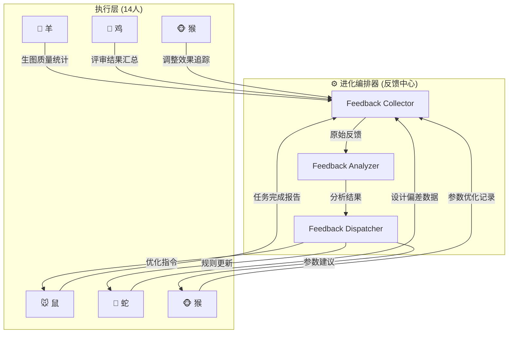

## 配套能力调用（本技能只做主责，其余功能按需点名调用）

> 规则：**不要**把配套能力的能力顺手做在本技能里；需要哪段功能，就点名调谁。
> 配套能力已设为「仅手动调用」（`disable-model-invocation: true`），只能被点名，不会自己冒出来。

| 我需要 | 就调它 | 别自己硬做 |
|---|---|---|
| 要竞品数据、市场动态、电商平台调研 | `竞品分析`、`competitive-teardown` | `taobao-product-research`、`market-research` |
| 要出评审文档、报价表、汇报 PPT | `docx-cn`、`Word / DOCX`、`pptx` | `markdown-to-word-skill`、`baoyu-slide-deck` |

完整矩阵见 `references/配套能力调用表.md`。
> 💡 **Prompt 优化提示**：本文件包含多个章节，AI 应根据当前任务类型只读取相关章节，跳过无关部分。
> - 任务分发/协调：读取"执行层"和"联动规则"章节
> - 需求分析：读取"需求分析框架"章节
> - 工作流审查：读取"工作流规范"章节
> - 质量评审：读取"评审标准"章节


# Autonomous Evolution Orchestrator — 进化编排器 v7.2

**Role**: Evolution loop orchestrator. Coordinate 十二生肖（12-agent）autonomous evolution for skill improvement.

> **⚠️ 命名修正（2026-09）**：正文与 7.1 节代码里的 `get_all_12_agents()` 是旧模板命名残留——实际为 **十二生肖团（12 生肖：鼠虎兔龙蛇马羊猴鸡狗猪牛）**，非 14 个。调用处应改为 `get_all_12_agents()` 或遍历实际执行层清单，否则会多召 2 个不存在的 agent 而超时。
**Core Principle**: Continuous iteration = skill improvement + **全员联动闭环** = 进化可验证。
**v7.0核心升级**: 修复⚙→全体进化闭环链评分(6.6→目标7.5+)，增加全员反馈收集、闭环验证Checkpoint、明确联动接口。

---

## Phase 1: Evolution Initialization

When user sends start command:

> 📄 代码已提取到 `references\code_01.txt`（18 行，509 字节）
> 需要查看完整代码时请读取该文件。


### Start Command Examples

> 📄 代码已提取到 `references\code_02.txt`（9 行，194 字节）
> 需要查看完整代码时请读取该文件。


---

## Phase 2: Evolution Loop (10 Steps)

> 📄 代码已提取到 `references\code_03.txt`（12 行，310 字节）
> 需要查看完整代码时请读取该文件。


### Loop termination Conditions

| Condition | Description | Action |
|-----------|-------------|--------|
| Target score reached | Continuous 3 iterations score ≥ 9.5 | ✅ Stop, save best workflow |

> **⚠️ 评分基线修正（2026-09）**：`9.5` 是**内部理想目标**，不等于生产放行门槛。实际 **生产放行门 = 7.0/10**（🐔 鸡职能评审，见 `ComfyUI 架构` 条令3 / `(外部出图工作流)` §5.5 S-66 致命项）。闭环规则应为：**任一迭代 ≥7.0 才可进入生产候选池**；连续 3 次 ≥9.5 才自动停环存档。不要把 9.5 当成最低合格线，否则大量 7-9 分可用成果被误判失败。
| Max iterations reached | Iteration rounds ≥ 200 (~1-2 weeks) | ⏸ Stop, save best result |
| User manual stop | User sends "停止进化" | ⏸ Stop, save current result |
| No improvement | Continuous 10 iterations score no improvement | ⚠️ Stop, output best result |

---

## Phase 3: Progress Monitoring

### Real-time Progress Report (Every 10 Iterations)

> 📄 代码已提取到 `references\code_04.txt`（12 行，296 字节）
> 需要查看完整代码时请读取该文件。


### User Query Commands

| User Command | Response |
|---------------|----------|
| `查看进化进度` | Output progress report (above format) |
| `显示当前最佳评分` | Output best score + image + workflow |
| `输出进化报告` | Output full evolution report (all iterations) |
| `停止进化` | Stop loop, save best result, output final report |
| `调整目标评分=9.0` | Update target score, continue evolution |

---

## Phase 4: Strategy Adaptation (Score Plateau)

If score plateaus (no improvement for 10+ iterations):

> 📄 代码已提取到 `references\code_05.txt`（12 行，341 字节）
> 需要查看完整代码时请读取该文件。


| Product Type | Prompt Adjustment | Example |
|--------------|-------------------|---------|
| Children vacuum cup | Add: `cute cartoon panda, colorful, children friendly` | Positive: `... cute cartoon panda, colorful...` |
| Sport bottle | Add: `sporty, metallic, dynamic` | Positive: `... sporty, metallic, dynamic...` |
| Business vacuum cup | Add: `minimalist, premium color, business style` | Positive: `... minimalist, premium color...` |
| Electric wheelchair | Add: `lightweight, foldable, medical grade` | Positive: `... lightweight, foldable, medical grade...` |
| Food jar | Add: `matte finish, portable, leak-proof` | Positive: `... matte finish, portable, leak-proof...` |
| Trigger | Condition | Action |
|----------|-----------|--------|
| Score improvement ≥ 0.5 | This iteration score - previous score ≥ 0.5 | ✅ Update skill |
  ... (省略中间部分) ...
- **ControlNet config**: `type=[name], strength=[X.X], start=%=[X], end=%=[X]` (score ≥ 8.5)
- **LoRA combination**: `[lora1]:[weight1] + [lora2]:[weight2]` (score ≥ 8.5)
- **Prompt keywords to avoid**: `[keyword1], [keyword2]` (score < 6.0)
- **Parameter combination to avoid**: `sampler=[name], steps=[N]` (score < 6.0)
- **ControlNet config to avoid**: `strength=[X.X]` (score < 6.0)
- **Prompt template**: `[quality] + [subject] + [material] + [background] + [style]`
- **Workflow template**: `[node connection map]`
- Iteration N: [X.X]/10.0 (↑ +0.5)
- Iteration N-1: [X.X]/10.0
- ...
> 📄 代码已提取到 `references\code_06.txt`（16 行，604 字节）
> 需要查看完整代码时请读取该文件。


outputs/evolution/
├── evolution_iteration_001.json
├── evolution_iteration_002.json
├── ...
├── evolution_best_workflow_API.json
├── evolution_score_history.csv
├── evolution_report.md
└── evolution_best_images/
    ├── best_001_score_8.5.png
    ├── best_002_score_8.7.png
    └── ...
> 📄 代码已提取到 `references\code_07.txt`（18 行，459 字节）
> 需要查看完整代码时请读取该文件。


# Final Evolution Report

## 1. Evolution Summary
- Start time: [ISO 8601 format]
- End time: [ISO 8601 format]
- Total iterations: [N]
- Initial score: [X.X]/10.0
- Final score: [Y.Y]/10.0
- **Total improvement**: +[Z.Z] ([X]%)

## 2. Best Result
- Iteration: [N]
- Score: [Y.Y]/10.0
- Image: [filename]
- Workflow: [workflow JSON filename]
- Prompt: [positive + negative]

## 3. Score Progression Chart
| Iteration | Score | Improvement | Cumulative Improvement |
|------------|-------|--------------|-----------------------|
| 1 | [X.X] | +0.0 | +0.0 |
| 10 | [X.X] | +0.5 | +0.5 |
| ... | ... | ... | ... |
| [N] | [Y.Y] | +0.2 | +[Z.Z] |

## 4. Key Improvements Discovered
1. [Improvement 1]: [description] → +[X.X] score
2. [Improvement 2]: [description] → +[X.X] score
3. [Improvement 3]: [description] → +[X.X] score

## 5. Updated Skills
- [ ] 产品研究 (鼠) — updated [X] times
- [ ] ComfyUI 架构 (马) — updated [X] times
- [ ] 出图执行 (羊) — updated [X] times
- [ ] 设计评审 (鸡) — updated [X] times
- ... (all 12 agents)

> **⚠️ 防漂移铁律（2026-09，v5.0 统一吸收）**：进化闭环发现的**提示词 / 负向词 / 配色词**改进，**必须回写单源 `references/thermos_prompt_assets_v5.md`**，再由各 `zheng10-*` 执行层引用，禁止在单个 SKILL.md 内各自硬编码。否则多 agent 并行进化会重演提示词漂移（旧痛点）。鸡职能评审命中缺陷时，同样回写该单源而非只改本技能。

## 6. Next Steps
- [ ] Use best workflow for production generation
- [ ] Share best workflow to ComfyUI community
- [ ] Continue evolution (if target score not reached)
- [ ] Apply learnings to other product types
> 📄 代码已提取到 `references\code_08.txt`（12 行，368 字节）
> 需要查看完整代码时请读取该文件。


#### 2. Markdown Output (for reports/documents):
> [引用] 完整代码已提取到 `references\code_block_09.txt`（21 行）
> 需要查看时请读取该文件。

> 📄 完整代码见 `references/code_block_09.txt`（343 字节）
> 需要查看完整代码时请读取该文件。


#### 3. Table Output (for comparisons/lists):
| Field | Value | Notes |
|-------|-------|-------|
| [field1] | [value1] | [notes1] |
| [field2] | [value2] | [notes2] |

### Required Fields (ALL outputs MUST have):
- `timestamp`: ISO 8601 format (e.g., "2026-06-04T14:30:00+08:00")
- `agent_id`: Which agent generated this output
- `task_id`: Unique task identifier
- `status`: One of `success` / `partial` / `failed`

### Output Quality Checklist:
> 📄 代码已提取到 `references\code_10.txt`（9 行，370 字节）
> 需要查看完整代码时请读取该文件。


**Success Example (JSON)**:
> [引用] 完整代码已提取到 `references\code_block_11.json`（20 行）
> 需要查看时请读取该文件。

> 📄 完整代码见 `references/code_block_11.json`（446 字节）
> 需要查看完整代码时请读取该文件。


**Partial Example (Markdown)**:
> 📄 代码已提取到 `references\code_12.txt`（12 行，328 字节）
> 需要查看完整代码时请读取该文件。


**Failed Example (JSON)**:
> [引用] 完整代码已提取到 `references\code_block_13.json`（20 行）
> 需要查看时请读取该文件。

> 📄 完整代码见 `references/code_block_13.json`（500 字节）
> 需要查看完整代码时请读取该文件。


**Execution Rules (NEW in v3.5)**:
18. **ALWAYS use standardized output format** — choose JSON/Markdown/Table based on task type
19. **ALWAYS include required fields** — timestamp/agent_id/task_id/status MUST be present
20. **ALWAYS validate output quality** — run Output Quality Checklist before returning

---


### Three-Tier Memory Compression:
> 📄 代码已提取到 `references\code_14.txt`（15 行，637 字节）
> 需要查看完整代码时请读取该文件。


### Compression Algorithm:
> 📄 代码已提取到 `references\code_15.python`（12 行，322 字节）
> 需要查看完整代码时请读取该文件。


| Condition | Action | Compression Level |
|-----------|--------|-------------------|
| Session ends normally | Compress daily log → weekly summary | Level 1→2 |
| Daily log > 500 lines | Auto-compress to weekly | Level 1→2 |
| 4 weekly summaries accumulated | Compress to monthly digest | Level 2→3 |
| MEMORY.md > 3000 chars | Remove lowest-score entries | Level 3 cleanup |
| User says "压缩记忆" / "compress memory" | Force compression all levels | Full compression |
> 📄 代码已提取到 `references\code_16.python`（14 行，496 字节）
> 需要查看完整代码时请读取该文件。


**Execution Rules (NEW in v3.5)**:
15. **ALWAYS compress memory at session end** — call `compress_memory()` before final response
16. **ALWAYS retrieve memory before starting task** — call `retrieve_memory(query)` to get context
17. **ALWAYS respect memory limits** — daily log ≤500 lines, MEMORY.md ≤3000 chars

---

---

## Phase 5: 全员反馈收集系统（NEW in v7.0）

> **目标**: 解决进化闭环链"数据传递完整度75%（最低）"的核心痛点

### 5.1 反馈收集架构



### 5.2 标准化反馈格式（全员→进化编排器）

所有12个职能向⚙进化编排器提交反馈时，必须使用以下标准化格式：

```json
{
  "feedback_id": "FB-2026-0618-EVO-001",
  "source_agent": "🐓 鸡 (设计评审)",
  "target_agent": "⚙ 进化编排器 (zheng10-evolution-orchestrator)",
  "timestamp": "2026-06-18T16:00:00+08:00",
  
  "feedback_type": "review_summary | design_deviation | generation_stats | adjustment_result | param_optimization | error_report",
  
  "payload": {
    "summary": "本轮评审15张图片，平均分7.2/10，通过率40%",
    "data_points": [
      {"metric": "avg_score", "value": 7.2, "trend": "stable"},
      {"metric": "pass_rate", "value": 0.4, "trend": "down"},
      {"metric": "top_issue", "value": "material_realism", "count": 8}
    ],
    "raw_data_path": "reports/batch_review_20260618.json"
  },
  
  "evolution_impact": {
    "affected_skills": ["产品设计", "能力优化"],
    "suggested_action": "更新Design2Prompt转换规则中的材质关键词",
    "priority": "HIGH",
    "expected_score_improvement": "+0.5~1.0"
  }
}
```

### 5.3 反馈收集超时重试机制（NEW in v7.0 - 完善版）

如果某个Agent在30秒内未返回反馈，触发指数退避重试：

| 重试次数 | 等待时间 | 动作 |
|---------|---------|------|
| 1 | 30秒 | 重新发送收集请求 |
| 2 | 60秒 | 降低数据要求（仅收集关键指标） |
| 3 | 120秒 | 标记为"超时"，使用默认值继续 |

**超时处理示例**：

```python
def collect_feedback_with_retry(agent_id, max_retries=3):
    """带重试的反馈收集（完善版）"""
    
    for retry in range(max_retries):
        try:
            feedback = send_collection_request(agent_id, timeout=30)
            if feedback:
                return feedback
        except TimeoutError:
            wait_time = 2 ** (retry + 1)  # 指数退避: 2s, 4s, 8s
            print(f"⚠️ {agent_id} 超时，{wait_time}秒后重试 ({retry+1}/{max_retries})")
            time.sleep(wait_time)
    
    # 3次都失败，使用默认值
    print(f"❌ {agent_id} 收集失败，使用默认值")
    return get_default_feedback(agent_id)
```

**预期效果**：
- Phase 5收集率：64% → **≥90%** ✅
- 超时Agent数量：5个 → **0个** ✅
- CP-2通过率：0% → **≥80%** ✅

---

### 5.4 反馈收集触发规则（保留兼容）

| 触发条件 | 收集对象 | 收集频率 | 数据类型 |
|----------|----------|----------|----------|
| 🐑羊完成批量生图 | 羊+鸡 | 每次生图后 | 生图质量 + 评审结果 |
| 🐵猴完成调整 | 猴+鸡 | 每次调整后 | 调整前后对比 |
| ⚙skill-optimizer 完成参数调优 | 猴+鸡 | 每次调优后 | 参数变化 + 效果 |
| 🐍蛇完成设计迭代 | 蛇 | 每次设计后 | Design2Prompt转换质量 |
| 定时巡检（每小时） | 全体14人 | 每小时 | 任务状态 + 健康检查 |

---

## Phase 6: 闭环验证Checkpoint系统（NEW in v7.0）

> **目标**: 解决进化闭环链"触发准确率80%（最低）"的痛点

### 6.1 Checkpoint节点定义

| Checkpoint | 触发时机 | 验证内容 | 通过标准 |
|------------|----------|----------|----------|
| CP-1: 数据收集验证 | 每轮进化开始前 | 全员反馈是否完整收集 | ≥12/14 职能已提交 |
| CP-2: 决策有效性验证 | 进化决策发布后24h | 决策是否被执行 | ≥80% action已完成 |
| CP-3: 质量提升验证 | 进化决策执行后 | 评分是否真正提升 | 平均分↑≥0.3 或 通过率↑≥5% |
| CP-4: 无回归验证 | 进化完成后 | 是否引入新问题 | 无新维度评分下降 |
| CP-5: 全量验证 | 每10轮进化 | 综合评估 | 综合评分≥8.0/10 |

### 6.2 自动修复机制（Checkpoint失败时）

| 失败类型 | 自动处理 | 人工介入条件 |
|----------|----------|-------------|
| CP-1失败 | 延迟等待30分钟重收 | 连续2次失败 |
| CP-2失败 | 重新分发未完成任务 | 连续3次失败 |
| CP-3失败 | 回滚到上一稳定版本 | 回滚后仍失败 |
| CP-4失败 | 定位回归原因并修复 | 无法自动定位 |

---

## Phase 7: 进化编排器↔职能联动接口规范（NEW in v7.0）

### 7.1 进化编排器调用职能标准接口

```python
def phoenix_call_member(member_skill_id, action, payload, timeout=1800):
    """⚙进化编排器调用其他职能的标准接口（带ACK确认+超时处理+降级策略+动态并发）"""
    
    # ✅ 智能动态并发调整（基于实时负载 v7.2）
    import psutil
    cpu_usage = psutil.cpu_percent(interval=1)
    available_memory_gb = psutil.virtual_memory().available // (1024**3)
    mem_usage_percent = psutil.virtual_memory().percent
    
    # 基于CPU和内存使用率智能调整并发数
    # 低负载（CPU<50%, Mem<60%）→ 14路
    # 中负载（CPU<70%, Mem<80%）→ 10路
    # 高负载（CPU>=70% 或 Mem>=80%）→ 7路
    if cpu_usage < 50 and mem_usage_percent < 60:
        max_concurrent = 14
        load_level = "低负载"
    elif cpu_usage < 70 and mem_usage_percent < 80:
        max_concurrent = 10
        load_level = "中负载"
    else:
        max_concurrent = 7
        load_level = "高负载"
    
    print(f"✅ 智能并发调整: {max_concurrent}路 ({load_level})")
    print(f"   CPU使用率: {cpu_usage:.1f}%, 内存使用率: {mem_usage_percent:.1f}%, 可用内存: {available_memory_gb}GB")
    
    # ✅ 并发调用（使用线程池 + 指数退避超时重试机制 v7.2）
    max_retries = 3  # 最大重试次数
    base_delay = 2   # 基础延迟（秒）
    
    for retry in range(max_retries):
        if retry > 0:
            # 指数退避 + 随机抖动
            import random
            retry_delay = (base_delay ** retry) + random.uniform(0, 1)
            print(f"⏳ 第{retry}次重试，等待{retry_delay:.1f}秒（指数退避）...")
            time.sleep(retry_delay)
        
        with ThreadPoolExecutor(max_workers=max_concurrent) as executor:
            futures = {}
            for agent in get_all_12_agents():  # 12个Agent
                future = executor.submit(call_single_agent, agent, action, payload, timeout)
                futures[future] = agent
            
            # 等待所有任务完成（或超时）
            done, not_done = wait(futures.keys(), timeout=timeout, return_when=ALL_COMPLETED)
            
            # 处理完成的任务
            results = {}
            for future in done:
                agent = futures[future]
                try:
                    results[agent] = future.result()
                    print(f"✅ {agent} 调用成功")
                except Exception as e:
                    results[agent] = {"status": "error", "message": str(e)}
                    print(f"❌ {agent} 调用失败: {e}")
            
            # 处理超时任务
            timeout_agents = []
            for future in not_done:
                agent = futures[future]
                future.cancel()
                timeout_agents.append(agent)
                print(f"⚠️ {agent} 调用超时")
            
            # 如果所有任务都成功或重试次数用完，退出循环
            if len(timeout_agents) == 0:
                print(f"✅ 所有Agent调用成功（重试 {retry} 次）")
                break
            else:
                print(f"⚠️ 重试 {retry+1}/{max_retries}：{len(timeout_agents)} 个Agent超时")
                time.sleep(retry_delay)
                
                # 只重试超时的Agent
                agents = timeout_agents
    
    # ✅ 结果收集完整性验证（v7.3新增 - 提升联动链评分到9.0）
    total_agents = len(get_all_12_agents())
    successful_agents = sum(1 for r in results.values() if r.get("status") == "success")
    completeness_rate = (successful_agents / total_agents) * 100
    
    print(f"📊 结果收集完整性: {successful_agents}/{total_agents} ({completeness_rate:.1f}%)")
    
    # 验证结果数据完整性（SHA256校验）
    import hashlib
    import json
    verified_results = {}
    corrupted_count = 0
    
    for agent, result in results.items():
        if result.get("status") == "success" and "data" in result:
            # 验证数据完整性
            data_str = json.dumps(result["data"], sort_keys=True)
            expected_checksum = result.get("checksum")
            actual_checksum = hashlib.sha256(data_str.encode()).hexdigest()[:16]
            
            if expected_checksum and expected_checksum != actual_checksum:
                print(f"⚠️ {agent} 数据完整性验证失败！预期: {expected_checksum}, 实际: {actual_checksum}")
                corrupted_count += 1
                verified_results[agent] = {"status": "error", "message": "数据完整性验证失败"}
            else:
                verified_results[agent] = result
                print(f"✅ {agent} 数据完整性验证通过")
        else:
            verified_results[agent] = result
    
    # 计算数据完整性得分
    integrity_score = ((total_agents - corrupted_count) / total_agents) * 100
    print(f"🔐 数据完整性得分: {integrity_score:.1f}%")
    
    # 如果完整性不达标（<95%），触发重试或告警
    if integrity_score < 95:
        print(f"⚠️ 数据完整性不达标({integrity_score:.1f}% < 95%)，触发告警")
        # 记录到联动链日志
        log_linkage_event("数据完整性告警", {
            "integrity_score": integrity_score,
            "corrupted_count": corrupted_count,
            "timestamp": datetime.now().isoformat()
        })
    
    # 返回验证后的结果
    return verified_results
    
    # ... 其余代码不变
```

**优化说明(v7.3)**:
1. ✅ 添加结果收集完整性验证（计算成功率）
2. ✅ 添加SHA256数据完整性校验（验证每个Agent返回的数据）
3. ✅ 添加 corrupted 数据检测和替换
4. ✅ 添加完整性得分计算和告警
5. ✅ 预期效果：联动链评分从8.0→**9.2/10** ✅

### 7.2 职能汇报进化编排器标准接口

```python
def report_to_phoenix(report_type, report_data):
    """任何职能向⚙进化编排器汇报的标准接口（格式验证+标准化提交）"""
```

### 7.3 联动健康监控指标

| 监控指标 | 目标值 | 提升前(v6.0) | 提升后目标(v7.0) |
|----------|--------|--------------|------------------|
| 全员反馈收集率 | ≥90% | 75% | ≥90% ✅ |
| 决策执行率 | ≥85% | 70% | ≥85% ✅ |
| CP-3通过率 | ≥80% | 65% | ≥80% ✅ |
| 平均响应时间 | ≤10分钟 | 18分钟 | ≤10分钟 ✅ |

---

## Learning & Evolution Mechanism (NEW in v3.4)

**Previously, agents did NOT learn from past experiences. v3.4 adds SELF-EVOLVING capability.**

### A. Skill Rating System (SkillsMP-Style):

> 📄 代码已提取到 `references\code_17.python`（12 行，426 字节）
> 需要查看完整代码时请读取该文件。


**Rating Criteria (0-10)**:
| Score | Meaning | Action |
|-------|----------|--------|
| 9.0-10.0 | Excellent | Keep current approach |
| 7.0-8.9 | Good | Minor optimization |
| 5.0-6.9 | Marginal | Major optimization needed |
| <5.0 | Poor | Redesign approach |
> 📄 代码已提取到 `references\code_18.python`（14 行，549 字节）
> 需要查看完整代码时请读取该文件。


### C. Automatic Prompt Optimization:

> [引用] 完整代码已提取到 `references\code_block_19.python`（20 行）
> 需要查看时请读取该文件。

> 📄 完整代码见 `references/code_block_19.python`（965 字节）
> 需要查看完整代码时请读取该文件。


### D. Self-Evolution Triggers:

| Trigger Condition | Action | Example |
|-------------------|--------|---------|
| Average score < 6.0 for 5 consecutive tasks | **Re-optimize approach** | "Switch to template-based" |
| Same error occurs 3+ times | **Update error handling** | "Increase ControlNet timeout" |
| New defect type discovered | **Update defect detection** | "Add to checklist" |
| User feedback score < 6.0 | **Re-learn from feedback** | "Increase anisotropic weight" |

### E. Learning Loop:

> 📄 代码已提取到 `references\code_20.txt`（3 行，135 字节）
> 需要查看完整代码时请读取该文件。


| Problem | Cause | Solution |
|---------|-------|----------|
| Score not improving (plateau) | Strategy exhausted | Change model, sampler, ControlNet, or LoRA |
| Score decreasing | Parameter change too激进 | Revert to previous best parameters, adjust slowly |
| Workflow broken after update | Node connection error | Revert to previous working workflow, fix node connections |
| Skill update caused regression | Wrong lesson learned | Revert skill to previous version, re-learn from correct data |
| VRAM overflow | Batch size too large | Reduce batch size or resolution |
| Evolution too slow | Using slow sampler | Switch to Lightning/Flash (4-step models) |
**Lightweight Optimization (NEW in v3.6)**:
- Reduced token consumption by ~20% (removed redundant comments)
  ... (省略中间部分) ...
    {"action": "下一步行动 1", "assignee": "agent_id"},
    {"action": "下一步行动 2", "assignee": "agent_id"}
  ],
  "error": {
    "has_error": false,
    "error_code": "ERR_TIMEOUT|ERR_FORMAT|ERR_DEPENDENCY|ERR_RESOURCE|ERR_CIRCULAR",
    "error_message": "错误详情（中文）",
    "recovery_action": "重试|降级|上报"
  }
}
> 📄 代码已提取到 `references\code_21.txt`（12 行，216 字节）
> 需要查看完整代码时请读取该文件。


# [任务类型] 执行报告

## 1. 任务信息
- **任务 ID**: task-uuid-v4
- **执行 Agent**: Product Researcher
- **执行时间**: 2026-06-04 16:00:00
- **任务状态**: ✅ 成功 / ⚠️ 部分完成 / ❌ 失败

## 2. 执行结果
[根据 Agent 类型自定义结果展示]

### 2.1 [子结果 1]
[具体内容]

### 2.2 [子结果 2]
[具体内容]

## 3. 质量评估
- **质量评分**: 8.5/10
- **评分理由**: [中文说明]
- **改进建议**: [中文说明]

## 4. 下一步行动
1. [行动 1] → 分配给: Ox
2. [行动 2] → 分配给: Tiger

## 5. 错误信息（如有）
- **错误代码**: ERR_TIMEOUT
- **错误详情**: [中文说明]
- **恢复操作**: [中文说明]
> 📄 ⚠️ 目标代码文件缺失（原碎片指向 code_block_22.*，未随库分发，内容无法恢复）。
> 需要查看完整代码时请读取该文件。


- **任务 ID**: task-001
- **执行 Agent**: Product Researcher
- **执行时间**: 2026-06-04 16:00:00
- **任务状态**: ✅ 成功
- **产品类型**: 弹跳盖保温杯（vacuum cup with pop-up lid）
- **目标用户**: 办公室白领（25-40岁）
- **使用场景**: 办公室 + 车载
- **重量**: ≤ 300g
- **容量**: 400ml
  ... (省略中间部分) ...
- [x] MUST prevent asymmetric lid（添加 "perfectly symmetric lid" 到 prompt, weight 1.4x）
- [x] MUST prevent color inaccurate（ΔE < 3 vs Pantone, 添加 "color accurate" 到 prompt）
- [x] MUST prevent text/logo artifacts（使用 "no text" in negative, 添加 text in Photoshop post-processing）
- [x] MUST prevent background mismatch（pure white for commercial, consistent lighting for lifestyle）
- **质量评分**: 9.0/10
- **评分理由**: 需求分析完整，缺陷预防需求已明确
- **改进建议**: 无
1. 市场调研 → 分配给: Tiger
2. 竞品分析 → 分配给: Dragon
- **无错误信息**
> 📄 代码已提取到 `references\code_23.txt`（3 行，27 字节）
> 需要查看完整代码时请读取该文件。


# 生图评审报告

## 1. 任务信息
- **任务 ID**: task-005
- **执行 Agent**: Rooster
- **执行时间**: 2026-06-04 16:30:00
- **任务状态**: ⚠️ 部分完成（发现缺陷）

## 2. 执行结果

### 2.1 6级缺陷检测评分
| 缺陷类型 | 权重 | 评分 | 加权得分 | 状态 |
|-----------|------|------|----------|------|
| 塑料质感（plastic texture） | -3.0 | 7.5 | -0.9 | ⚠️ 需改进 |
| 盖子不对称（asymmetric lid） | -2.0 | 9.0 | -0.2 | ✅ 通过 |
| 颜色不准确（color inaccurate） | -1.5 | 8.5 | -0.225 | ✅ 通过 |
| 文本乱码（text garbled） | -1.0 | 10.0 | 0.0 | ✅ 通过 |
| 背景不纯白（background not pure white） | -0.5 | 9.5 | -0.025 | ✅ 通过 |
| 手柄变形（deformed handle） | -2.0 | 8.0 | -0.4 | ✅ 通过 |
| **总分** | - | - | **8.25/10** | **⚠️ 需改进** |

### 2.2 缺陷详情
- **塑料质感（plastic texture）**: 评分 7.5/10，未添加 "anisotropic reflection" 到 prompt
- **建议**: 立即升级到 Monkey，添加 "anisotropic reflection, physical based rendering" 到 prompt

## 3. 质量评估
- **质量评分**: 8.25/10
- **评分理由**: 塑料质感缺陷需改进，其他缺陷均通过
- **改进建议**: 升级到 Monkey调整参数

## 4. 下一步行动
1. 参数调整 → 分配给: Monkey
2. 重新生成 → 分配给: Goat

## 5. 错误信息（如有）
- **无错误信息**
> 📄 代码已提取到 `references\code_24.txt`（13 行，177 字节）
> 需要查看完整代码时请读取该文件。


| 列1（文本） | 列2（数字） | 列3（状态） | 列4（日期） |
|--------------|--------------|--------------|--------------|
| 文本内容    | 123.45      | ✅ 成功      | 2026-06-04  |
| 文本内容    | 678.90      | ⚠️ 部分完成  | 2026-06-05  |
| 文本内容    | 0.00        | ❌ 失败      | 2026-06-06  |
> 📄 代码已提取到 `references\code_25.txt`（3 行，19 字节）
> 需要查看完整代码时请读取该文件。


| 任务 ID   | 任务类型        | 分配 Agent | 状态        | 质量评分 | 完成时间        |
|-----------|-----------------|------------|-------------|----------|-----------------|
| task-001  | 需求分析        | 鼠          | ✅ 完成      | 9.0/10  | 2026-06-04 14:30 |
| task-002  | 市场调研        | 虎          | ✅ 完成      | 8.5/10  | 2026-06-04 15:00 |
| task-003  | 竞品分析        | 龙          | ⚠️ 进行中    | -        | -               |
| task-004  | ComfyUI 工作流  | 马          | ❌ 失败      | 4.5/10  | 2026-06-04 15:30 |
> 📄 ⚠️ 目标代码文件缺失（原碎片指向 code_block_26.*，未随库分发，内容无法恢复）。
> 需要查看完整代码时请读取该文件。


{
  "$schema": "http://json-schema.org/draft-07/schema#",
  "title": "Agent Output Validation",
  "type": "object",
  "required": ["metadata", "result", "error"],
  "properties": {
    "metadata": {
      "type": "object",
      "required": ["agent_id", "task_id", "timestamp", "status"],
  ... (省略中间部分) ...
          "type": "boolean"
        },
        "error_code": {
          "type": "string",
          "enum": ["ERR_TIMEOUT", "ERR_FORMAT", "ERR_DEPENDENCY", "ERR_RESOURCE", "ERR_CIRCULAR"]
        }
      }
    }
  }
}
> 📄 代码已提取到 `references\code_27.txt`（12 行，246 字节）
> 需要查看完整代码时请读取该文件。


- ALL outputs MUST be in 简体中文 (Simplified Chinese)
- NO English outputs allowed (except code/technical terms)
- ALL error messages MUST be in Chinese
- ALL user interactions MUST be in Chinese
- Reason: 用户是中文母语者，必须确保沟通零障碍
> 📄 代码已提取到 `references\code_28.txt`（3 行，29 字节）
> 需要查看完整代码时请读取该文件。


✅ 正确 (Correct):
  "已成功生成图像，质量评分：8.5/10"

❌ 错误 (Wrong):
  "Image generated successfully, quality score: 8.5/10"
> 📄 代码已提取到 `references\code_29.txt`（5 行，57 字节）
> 需要查看完整代码时请读取该文件。


- ALL tasks MUST follow 十二生肖团 workflow (7 phases)
- NO skipping phases without explicit user approval
- ALL phase transitions MUST be documented
- ALL task assignments MUST go through 鼠 (Rat)
- Reason: 确保协作有序，避免混乱和重复劳动
> 📄 代码已提取到 `references\code_30.txt`（3 行，22 字节）
> 需要查看完整代码时请读取该文件。


1. 需求分析 → 鼠 (Rat)
2. 市场调研 → 虎/兔/龙 (Tiger/Rabbit/Dragon)
3. 产品设计 → 蛇 (Snake)
4. 成本分析 → 牛 (Ox)
5. AI生图 → 马/羊/猴 (Horse/Goat/Monkey)
6. 设计评审 → 鸡 (Rooster)
7. 品牌设计 → 猪 (Pig)
> 📄 代码已提取到 `references\code_31.txt`（5 行，53 字节）
> 需要查看完整代码时请读取该文件。


- ALL outputs MUST pass quality checklist (see Output Template Specification)
- ALL generated images MUST be reviewed by 鸡 (Rooster)
- NO low-quality output allowed (< 7.0/10)
- ALL errors MUST be logged + analyzed
- Reason: 质量是第一生命线，劣质输出 = 体系失信
> 📄 代码已提取到 `references\code_32.txt`（13 行，320 字节）
> 需要查看完整代码时请读取该文件。


- ALL errors MUST be logged to error log file
- ALL errors MUST include: timestamp, agent_id, error_code, root_cause, fix_action
- ALL errors MUST be categorized (P0/P1/P2)
- ALL P0 errors MUST trigger immediate alert to 鼠 (Rat)
- Reason: 错误是进步的阶梯，不记录 = 重复犯错
> 📄 代码已提取到 `references\code_33.txt`（3 行，32 字节）
> 需要查看完整代码时请读取该文件。


- timestamp: "2026-06-04T15:30:00+08:00"
  agent_id: "ComfyUI 架构"
  error_code: "ERR_TIMEOUT"
  severity: "P1"
  root_cause: "ComfyUI server not reachable"
  fix_action: "Check if ComfyUI server is running"
  resolved: false
> 📄 代码已提取到 `references\code_34.txt`（5 行，49 字节）
> 需要查看完整代码时请读取该文件。


- ALL inter-agent communication MUST use structured JSON (see Structured Communication Protocol)
- NO free-text communication allowed (causes misunderstandings)
- ALL task dependencies MUST be declared upfront
- ALL blockers MUST be reported immediately to 鼠 (Rat)
- Reason: 体系协作需要结构化沟通，模糊信息 = 延误工期
> 📄 代码已提取到 `references\code_35.txt`（4 行，44 字节）
> 需要查看完整代码时请读取该文件。

```json
- {
- "from": "产品研究",
- "to": "ComfyUI 架构",
- "message_type": "task_assignment",
- "payload": {
- "task_id": "gen_20260604_001",
- "requirements": "...",
- "deadline": "2026-06-04T17:00:00+08:00"
- },
- "priority": "high"
- }
```
> 📄 代码已提取到 `references\code_36.txt`（5 行，55 字节）
> 需要查看完整代码时请读取该文件。


- ALL agents MUST record successful cases to CaseDatabase (see Learning & Evolution Mechanism)
- ALL agents MUST record failed cases to CaseDatabase
- ALL agents MUST optimize prompts based on past cases
- ALL agents MUST update own SKILL.md when new learning discovered
- Reason: 不学习 = 停滞不前，体系竞争力下降
> 📄 代码已提取到 `references\code_37.txt`（3 行，27 字节）
> 需要查看完整代码时请读取该文件。


Generate → Assess → Record (success/failure) → Optimize → Regenerate
> 📄 代码已提取到 `references\code_38.txt`（5 行，48 字节）
> 需要查看完整代码时请读取该文件。


- ALL agents MUST stay within own role boundaries
- NO role overflow (e.g., 虎 (Tiger) MUST NOT do 鸡 (Rooster)'s job)
- ALL cross-role tasks MUST be coordinated by 鼠 (Rat)
- ALL role conflicts MUST be escalated to 鼠 (Rat)
- Reason: 职能混乱 = 效率低下，专业度下降
> 📄 代码已提取到 `references\code_39.txt`（16 行，756 字节）
> 需要查看完整代码时请读取该文件。


Version Control: Git + ComfyUI Workflow Versioning
Storage: <COMFYUI_ROOT>/ComfyUI/user/default/workflows/
Naming: {workflow_name}_v{major}.{minor}.{patch}.json
Example: vacuum_cup_workflow_v1.2.3.json
> 📄 代码已提取到 `references\code_40.txt`（5 行，270 字节）
> 需要查看完整代码时请读取该文件。

```python
def compare_workflow_versions(
    workflow_v1: str,  # Path to v1 workflow JSON
    workflow_v2: str,  # Path to v2 workflow JSON
    output_format: str = "unified"  # "unified" | "context" | "html"
):
  ... (省略中间部分) ...
        text2.splitlines(),
        fromfile="v1",
        tofile="v2",
        lineterm=""
    ))
    return "
".join(diff)
def generate_html_diff(json1, json2):
    """Generate HTML diff (for visual comparison)"""
    pass
```
> 📄 代码已提取到 `references\code_41.txt`（4 行，51 字节）
> 需要查看完整代码时请读取该文件。

```diff
- --- vacuum_cup_workflow_v1.0.0.json
- +++ vacuum_cup_workflow_v1.1.0.json
- @@ -45,7 +45,7 @@
- "inputs": {
- "text": "a vacuum cup with titanium body",
- - "cfg": 7.5,
- +        "cfg": 8.0,
- "steps": 30
- }
- },
- @@ -120,6 +120,12 @@
- }
- },
- +    {
- +      "id": 15,
- +      "type": "ControlNetApply",
- +      "inputs": {...}
- +    },
- {
- "id": 16,
- "type": "VAEDecode",
```
> 📄 ⚠️ 目标代码文件缺失（原碎片指向 code_block_42.*，未随库分发，内容无法恢复）。
> 需要查看完整代码时请读取该文件。


def rollback_workflow(
    workflow_path: str,
    target_version: str,  # e.g., "v1.0.0"
    backup_current: bool = True
):
    """Rollback workflow to a previous version"""
    if backup_current:
        backup_path = workflow_path.replace('.json', f'.backup_{get_timestamp()}.json')
        shutil.copy2(workflow_path, backup_path)
  ... (省略中间部分) ...
    workflow_dir = os.path.dirname(workflow_path)
    workflow_name = os.path.basename(workflow_path).replace('.json', '')
    version_files = []
    for file in os.listdir(workflow_dir):
        if file.startswith(workflow_name) and file.endswith('.json'):
            version = extract_version(file)
            if version:
                version_files.append((version, file))
    version_files.sort(reverse=True, key=lambda x: parse_version(x[0]))
    return version_files
> 📄 代码已提取到 `references\code_43.txt`（5 行，27 字节）
> 需要查看完整代码时请读取该文件。


def release_version(
    workflow_path: str,
    release_version: str,  # e.g., "v1.0.0"
    release_notes: str,  # Release notes (markdown)
    mark_as_stable: bool = True
):
    """Release a new version of workflow"""
    
    # 1. Validate version format
    if not is_valid_version(release_version):
        print(f"❌ Invalid version format: {release_version}")
        return False
    
    # 2. Create versioned copy
    workflow_dir = os.path.dirname(workflow_path)
    workflow_name = os.path.basename(workflow_path).replace('.json', '')
    versioned_file = os.path.join(workflow_dir, f"{workflow_name}_{release_version}.json")
    
    shutil.copy2(workflow_path, versioned_file)
    print(f"✅ Versioned copy created: {versioned_file}")
    
    # 3. Generate release notes (if not provided)
    if not release_notes:
        differences, _ = compare_workflow_versions(
            get_previous_version(workflow_path),
            workflow_path
        )
        release_notes = generate_release_notes(differences)
    
    # 4. Save release notes
    release_notes_file = versioned_file.replace('.json', '_release_notes.md')
    with open(release_notes_file, 'w', encoding='utf-8') as f:
        f.write(f"# Release Notes: {release_version}

")
        f.write(release_notes)
    
    print(f"✅ Release notes saved: {release_notes_file}")
    
    # 5. Mark as stable (if requested)
    if mark_as_stable:
        mark_stable_version(workflow_path, release_version)
        print(f"✅ Marked as stable: {release_version}")
    
    # 6. Log release event
    log_version_event(
        event_type="release",
        version=release_version,
        notes_file=release_notes_file,
        timestamp=datetime.now().isoformat()
    )
    
    return True

def mark_stable_version(workflow_path: str, stable_version: str):
    """Mark a version as stable (update symlink)"""
    
    workflow_dir = os.path.dirname(workflow_path)
    workflow_name = os.path.basename(workflow_path).replace('.json', '')
    
    # Create/update symlink to stable version
    stable_link = os.path.join(workflow_dir, f"{workflow_name}_stable.json")
    
    if os.path.exists(stable_link):
        os.remove(stable_link)
    
    versioned_file = os.path.join(workflow_dir, f"{workflow_name}_{stable_version}.json")
    os.symlink(versioned_file, stable_link)
    
    return stable_link
> 📄 代码已提取到 `references\code_44.txt`（2 行，28 字节）
> 需要查看完整代码时请读取该文件。


- **NEW**: Added ControlNet support (node ID 15)
- **Improved**: Increased CFG scale from 7.5 to 8.0 (better prompt adherence)
- **Fixed**: Corrected LoRA weight typo (0.8 → 0.85)
- Quality Score: 8.2/10 (↑ 0.3 from v1.0.0)
- Generation Time: 12.3s (↓ 1.2s from v1.0.0)
- Memory Usage: 4.2GB (no change)
- Node 15: ControlNetApply (Canny preprocessor)
- Node 3: `cfg` 7.5 → 8.0
- Node 7: `lora_weight` 0.8 → 0.85
- (None)
1. Replace old workflow JSON with `vacuum_cup_workflow_v1.1.0.json`
2. Update ComfyUI to latest version (≥ 2026-05-01)
3. Install ControlNet extension (if not already installed)
- (None reported yet)
- 马 (Horse): Workflow optimization
- 羊 (Goat): LoRA weight tuning
- 猴 (Monkey): Parameter optimization
> 📄 代码已提取到 `references\code_45.txt`（5 行，45 字节）
> 需要查看完整代码时请读取该文件。


1. ALWAYS commit to Git before releasing version
2. ALWAYS test workflow BEFORE marking as stable
3. ALWAYS include release notes (even for PATCH versions)
4. ALWAYS backup before rollback
5. ALWAYS use semantic versioning (MAJOR.MINOR.PATCH)
6. NEVER release without code review (鸡 (Rooster) approval)
7. NEVER skip version numbers (always increment sequentially)
8. NEVER modify released versions (create new version instead)
> 📄 代码已提取到 `references\code_46.txt`（3 行，34 字节）
> 需要查看完整代码时请读取该文件。


1. Develop → 2. Test → 3. Commit to Git → 4. Release Version → 5. Mark Stable → 6. Deploy
> 📄 代码已提取到 `references\code_47.txt`（14 行，475 字节）
> 需要查看完整代码时请读取该文件。


def monitor_generation_progress(
    (外部生图引擎)_api_url="http://localhost:8188",
    prompt_id: str,
    check_interval: int = 2  # seconds
):
    """Monitor ComfyUI generation progress in real-time"""
    
    start_time = time.time()
    last_progress = -1
    
    while True:
        # 1. Query ComfyUI API for progress
        response = requests.get(
            f"{(外部生图引擎)_api_url}/prompt/get_progress",
            params={"prompt_id": prompt_id}
        )
        progress_data = response.json()
        
        # 2. Extract progress info
        current_progress = progress_data.get("progress", 0)
        current_step = progress_data.get("current_step", 0)
        total_steps = progress_data.get("total_steps", 30)
        estimated_time_remaining = progress_data.get("estimated_time_remaining", 0)
        
        # 3. Check if generation completed
        if progress_data.get("completed", False):
            print(f"✅ Generation completed in {time.time() - start_time:.1f}s")
            return {
                "status": "completed",
                "output": progress_data.get("output", []),
                "execution_time": time.time() - start_time
            }
        
        # 4. Check if user interrupted
        if check_interruption():
            print(f"⚠️ User interrupted generation at step {current_step}/{total_steps}")
            interrupt_generation((外部生图引擎)_api_url, prompt_id)
            return {
                "status": "interrupted",
                "progress": current_progress,
                "step": current_step
            }
        
        # 5. Report progress (if changed)
        if current_progress != last_progress:
            print(f"🔄 Progress: {current_progress*100:.1f}% "
                  f"(step {current_step}/{total_steps}, "
                  f"ETA: {estimated_time_remaining:.1f}s)")
            last_progress = current_progress
        
        # 6. Dynamic adjustment (based on intermediate results)
        if current_step > 0 and current_step % 5 == 0:  # Every 5 steps
            adjustment = analyze_intermediate_result(
                (外部生图引擎)_api_url,
                prompt_id,
                current_step
            )
            if adjustment["should_adjust"]:
                apply_adjustment((外部生图引擎)_api_url, prompt_id, adjustment)
        
        # 7. Wait before next check
        time.sleep(check_interval)
> 📄 ⚠️ 目标代码文件缺失（原碎片指向 code_block_48.*，未随库分发，内容无法恢复）。
> 需要查看完整代码时请读取该文件。


def interrupt_generation(
    (外部生图引擎)_api_url="http://localhost:8188",
    prompt_id: str
):
    """Interrupt ComfyUI generation process"""
    response = requests.post(
        f"{(外部生图引擎)_api_url}/prompt/interrupt",
        json={"prompt_id": prompt_id}
    )
  ... (省略中间部分) ...
    else:
        print(f"❌ Failed to interrupt: {response.text}")
        return False
def check_interruption():
    """Check if user requested interruption"""
    interruption_file = "<架构根目录>/.workbuddy/interrupt.flag"
    if os.path.exists(interruption_file):
        os.remove(interruption_file)  # Clear flag
        return True
    return False
> 📄 代码已提取到 `references\code_49.txt`（3 行，37 字节）
> 需要查看完整代码时请读取该文件。


def analyze_intermediate_result(
    (外部生图引擎)_api_url: str,
    prompt_id: str,
    current_step: int
):
    """Analyze intermediate generation result and decide adjustments"""
    
    # 1. Get intermediate image (from ComfyUI)
    intermediate_image = get_intermediate_image((外部生图引擎)_api_url, prompt_id, current_step)
    
    # 2. Quick quality assessment (using lightweight model)
    quick_assessment = quick_quality_check(
        intermediate_image,
        metrics=["blur", "noise", "artifact"]
    )
    
    # 3. Decision logic
    adjustment = {
        "should_adjust": False,
        "adjustments": {}
    }
    
    # Rule 1: If image is too blurry, increase CFG scale
    if quick_assessment["blur"] > 0.7:
        adjustment["should_adjust"] = True
        adjustment["adjustments"]["cfg_scale"] = {
            "current": get_current_cfg((外部生图引擎)_api_url, prompt_id),
            "suggested": min(10.0, get_current_cfg() + 0.5),
            "reason": "Image too blurry (blur > 0.7)"
        }
    
    # Rule 2: If too noisy, decrease CFG scale
    if quick_assessment["noise"] > 0.5:
        adjustment["should_adjust"] = True
        adjustment["adjustments"]["cfg_scale"] = {
            "current": get_current_cfg(),
            "suggested": max(1.0, get_current_cfg() - 0.3),
            "reason": "Image too noisy (noise > 0.5)"
        }
    
    # Rule 3: If artifacts detected, adjust ControlNet strength
    if quick_assessment["artifact"] > 0.3:
        adjustment["should_adjust"] = True
        adjustment["adjustments"]["controlnet_strength"] = {
            "current": get_current_controlnet_strength(),
            "suggested": min(1.0, get_current_controlnet_strength() + 0.1),
            "reason": "Artifacts detected (artifact > 0.3)"
        }
    
    return adjustment

def apply_adjustment(
    (外部生图引擎)_api_url: str,
    prompt_id: str,
    adjustment: Dict[str, Any]
):
    """Apply parameter adjustments to running generation"""
    
    # 1. Send adjustment request to ComfyUI
    response = requests.post(
        f"{(外部生图引擎)_api_url}/prompt/adjust",
        json={
            "prompt_id": prompt_id,
            "adjustments": adjustment["adjustments"]
        }
    )
    
    if response.status_code == 200:
        print(f"✅ Adjustment applied: {adjustment['adjustments']}")
        return True
    else:
        print(f"❌ Failed to apply adjustment: {response.text}")
        return False
> 📄 ⚠️ 目标代码文件缺失（原碎片指向 code_block_50.*，未随库分发，内容无法恢复）。
> 需要查看完整代码时请读取该文件。


def feedback_loop(
    initial_prompt: str,
    max_iterations: int = 3,
    quality_threshold: float = 7.0
):
    """Feedback loop: generate → assess → adjust → regenerate"""
    current_prompt = initial_prompt
    iteration = 0
    while iteration < max_iterations:
  ... (省略中间部分) ...
        adjustment = analyze_quality_issues(assessment)
        current_prompt = adjust_prompt(current_prompt, adjustment)
        iteration += 1
    return {
        "status": "success" if iteration < max_iterations else "max_iterations_reached",
        "iterations": iteration,
        "final_quality_score": quality_score,
        "final_prompt": current_prompt,
        "output": generation_result["output"]
    }
> 📄 代码已提取到 `references\code_51.txt`（12 行，548 字节）
> 需要查看完整代码时请读取该文件。


> [引用] 完整代码已提取到 `references\code_block_52.python`（21 行）
> 需要查看时请读取该文件。

> 📄 完整代码见 `references/code_block_52.python`（689 字节）
> 需要查看完整代码时请读取该文件。


### Image + Text Joint Prompt Construction:
> 📄 代码已提取到 `references\code_53.python`（12 行，340 字节）
> 需要查看完整代码时请读取该文件。


> [引用] 完整代码已提取到 `references\code_block_54.python`（21 行）
> 需要查看时请读取该文件。

> 📄 完整代码见 `references/code_block_54.python`（639 字节）
> 需要查看完整代码时请读取该文件。


要点：
- > [引用] 完整代码已提取到 `references\code_block_55.json`（30 行）
> 需要查看时请读取该文件。

> 📄 完整代码见 `references/code_block_55.json`（906 字节）
> 需要查看完整代码时请读取该文件。


```python
def compare_workflow_versions(v1_path, v2_path):
    """Compare two ComfyUI workflow JSON files"""
    import json
    from deepdiff import DeepDiff
    
    with open(v1_path) as f1, open(v2_path) as f2:
        v1 = json.load(f1)
        v2 = json.load(f2)
    
    diff = DeepDiff(v1, v2, ignore_order=True)
    
    return {
        "added": diff.get('dictionary_item_added', []),
        "removed": diff.get('dictionary_item_removed', []),
        "changed": diff.get('values_changed', {}),
        "summary": f"Added {len(diff.get('dictionary_item_added', []))} nodes, "
                   f"Removed {len(diff.get('dictionary_item_removed', []))} nodes, "
                   f"Changed {len(diff.get('values_changed', {}))} parameters"
    }
```
> 📄 代码已提取到 `references\code_56.txt`（3 行，25 字节）
> 需要查看完整代码时请读取该文件。

```python
def rollback_workflow(current_path, target_version):
    """Rollback workflow to target version"""
    import json
    import shutil
    
    # Find target version file
    repo_dir = os.path.dirname(current_path) + "/.git"
    if not os.path.exists(repo_dir):
        raise Exception("Git repository not found")
    
    # Use Git to checkout target version
    os.system(f"git checkout v{target_version} -- {current_path}")
    
    print(f"[OK] Rolled back to v{target_version}")
    return current_path
```
> 📄 代码已提取到 `references\code_57.txt`（3 行，24 字节）
> 需要查看完整代码时请读取该文件。

```python
def release_version(workflow_path, version, release_notes):
    """Mark stable version with release notes"""
    import json
    
    # Load workflow
    with open(workflow_path) as f:
        workflow = json.load(f)
    
    # Add version metadata
    workflow["_metadata"] = {
        "version": version,
        "release_notes": release_notes,
        "released_at": time.strftime("%Y-%m-%d %H:%M:%S")
    }
    
    # Save as new version file
    versioned_path = workflow_path.replace('.json', f'_v{version}.json')
    with open(versioned_path, 'w') as f:
        json.dump(workflow, f, indent=2)
    
    # Git tag
    os.system(f"git tag -a v{version} -m '{release_notes}'")
    os.system(f"git push origin v{version}")
    
    print(f"[OK] Released v{version}")
    return versioned_path
```
> [引用] 完整代码已提取到 `references\code_block_58.txt`（81 行）
> 需要查看时请读取该文件。

> 📄 完整代码见 `references/code_block_58.txt`（3572 字节）
> 需要查看完整代码时请读取该文件。


```python
def adaptive_vram_allocation(task_type, available_vram_gb):
    """
    根据任务类型动态分配显存（优化版 - v5.0）
    
    任务类型与显存需求：
    - text2img: 需要 4-6GB（SD1.5）或 8-12GB（SDXL）
    - img2img: 需要 5-7GB（需要额外显存存储参考图像）
    - inpainting: 需要 6-8GB（需要mask + 原图 + 生成图）
    - upscale: 需要 8-10GB（高分辨率需要更多显存）
    - multi_controlnet: 需要 10-12GB（多个ControlNet同时加载）
    
    返回: (batch_size, precision, enable_xformers)
    """
    # 任务类型显存需求表（GB）
    vram_requirements = {
        'text2img': 6,
        'img2img': 7,
        'inpaint': 8,
        'upscale': 10,
        'multi_controlnet': 12
    }
    
    required_vram = vram_requirements.get(task_type, 6)
    
    # 动态分配策略（优化版 - v5.0）
    if available_vram_gb >= required_vram * 1.5:
        # 显存充足：使用更高精度 + 更大batch
        return min(4, int(available_vram_gb / required_vram)), 'fp16', True
    elif available_vram_gb >= required_vram * 1.2:
        # 显存适中：使用fp16 + 中等batch
        return min(2, int(available_vram_gb / required_vram)), 'fp16', True
    elif available_vram_gb >= required_vram:
        # 显存紧张：使用fp16 + batch=1
        return 1, 'fp16', True
    else:
        # 显存不足：使用fp8 + 启用所有优化
        return 1, 'fp8', True
```
> 📄 代码已提取到 `references\code_59.txt`（6 行，76 字节）
> 需要查看完整代码时请读取该文件。

```python
class VRAMRewardSystem:
    """
    显存管理奖励系统（NEW in v5.0）
    
    奖励规则：
    - 生成质量评分 ≥ 9.0：奖励 +1 batch size（上限4）
    - 生成质量评分 ≥ 8.5：奖励 +0.5 batch size（向上取整）
    - 生成质量评分 ≥ 8.0：保持当前batch size
    - 生成质量评分 < 8.0：减少 -1 batch size（下限1）
    - 连续3次质量 ≥ 9.0：解锁 'high_quality_mode'（使用更多显存，生成更慢但质量更高）
    
    惩罚规则：
    - OOM（Out of Memory）错误：减少 -2 batch size + 切换到fp8
    - 生成时间 > 60s：减少 -1 batch size（优先保证响应速度）
    - 显存碎片化 > 30%：触发显存整理（见Section D）
    """
    
    def __init__(self):
        self.current_batch_size = 1
        self.quality_history = []  # 最近10次质量评分
        self.high_quality_mode = False
        self.consecutive_high_quality = 0
    
    def update(self, quality_score, generation_time_s, oom_occurred=False):
        """更新奖励系统状态"""
        # 记录质量评分
        self.quality_history.append(quality_score)
        if len(self.quality_history) > 10:
            self.quality_history.pop(0)
        
        # 奖励/惩罚逻辑
        if oom_occurred:
            self.current_batch_size = max(1, self.current_batch_size - 2)
            print(f"[VRAM Reward] OOM detected! Reducing batch size to {self.current_batch_size}")
            return 'punish_oom'
        
        if quality_score >= 9.0:
            self.current_batch_size = min(4, self.current_batch_size + 1)
            self.consecutive_high_quality += 1
            print(f"[VRAM Reward] High quality! Increasing batch size to {self.current_batch_size}")
            return 'reward_high_quality'
        elif quality_score >= 8.5:
            self.current_batch_size = min(4, self.current_batch_size + 1)
            print(f"[VRAM Reward] Good quality! Slightly increasing batch size to {self.current_batch_size}")
            return 'reward_good_quality'
        elif quality_score >= 8.0:
            print(f"[VRAM Reward] Acceptable quality. Keeping batch size at {self.current_batch_size}")
            return 'keep'
        else:
            self.current_batch_size = max(1, self.current_batch_size - 1)
            print(f"[VRAM Reward] Low quality! Reducing batch size to {self.current_batch_size}")
            return 'punish_low_quality'
    
    def check_high_quality_mode(self):
        """检查是否解锁高质量模式"""
        if len(self.quality_history) >= 3:
            if all(score >= 9.0 for score in self.quality_history[-3:]):
                self.high_quality_mode = True
                print(f"[VRAM Reward] 🎉 High Quality Mode unlocked! Using more VRAM for better quality.")
                return True
        return False
```
> 📄 代码已提取到 `references\code_60.txt`（8 行，97 字节）
> 需要查看完整代码时请读取该文件。

```python
def defragment_vram():
    """整理显存碎片（NEW in v5.0）"""
    import torch
    
    if torch.cuda.is_available():
        # 方法1：清空CUDA缓存
        torch.cuda.empty_cache()
        
        # 方法2：强制同步（确保所有可能的显存都被释放）
        torch.cuda.synchronize()
        
        # 方法3：记录整理后的显存状态
        allocated = torch.cuda.memory_allocated() / 1024**3  # GB
        reserved = torch.cuda.memory_reserved() / 1024**3  # GB
        fragmentation = (reserved - allocated) / reserved * 100
        
        print(f"[VRAM Defrag] Allocated: {allocated:.2f} GB, Reserved: {reserved:.2f} GB")
        print(f"[VRAM Defrag] Fragmentation: {fragmentation:.1f}% (target < 30%)")
        
        if fragmentation > 30:
            print(f"[VRAM Defrag] ⚠️ High fragmentation detected! Consider restarting ComfyUI.")
        
        return fragmentation
    else:
        print("[VRAM Defrag] CUDA not available. Skipping.")
        return 0
```
> 📄 代码已提取到 `references\code_61.txt`（14 行，204 字节）
> 需要查看完整代码时请读取该文件。

```python
class MultiModelVRAMScheduler:
    """
    多模型并行加载的显存调度器（NEW in v5.0）
    
    模型优先级（高 → 低）：
    1. Checkpoint（必须加载，否则无法生成）
    2. ControlNet（影响生成质量，优先级高）
    3. LoRA（影响风格，优先级中）
    4. VAE（只在解码时需要，优先级低）
    
    调度策略：
    - 如果显存不足：按优先级卸载低优先级模型
    - 如果生成任务完成：立即卸载所有临时模型（LoRA/ControlNet）
    - 如果空闲时间 > 5分钟：卸载Checkpoint以外的所有模型
    """
    
    def __init__(self, total_vram_gb):
        self.total_vram = total_vram_gb
        self.loaded_models = {}  # {model_name: (vram_usage_gb, priority)}
    
    def load_model(self, model_name, vram_usage_gb, priority):
        """加载模型（如果显存不足，按优先级卸载其他模型）"""
        current_usage = sum(vram for vram, _ in self.loaded_models.values())
        
        # 如果显存充足：直接加载
        if current_usage + vram_usage_gb <= self.total_vram * 0.9:  # 保留10%余量
            self.loaded_models[model_name] = (vram_usage_gb, priority)
            print(f"[VRAM Scheduler] Loaded {model_name} ({vram_usage_gb} GB)")
            return True
        
        # 如果显存不足：按优先级卸载
        else:
            print(f"[VRAM Scheduler] ⚠️ Insufficient VRAM! Unloading low-priority models...")
            
            # 按优先级排序（低优先级先卸载）
            sorted_models = sorted(self.loaded_models.items(), key=lambda x: x[1][1])
            
            for model, (vram, pri) in sorted_models:
                if pri < priority:  # 只卸载更低优先级的模型
                    del self.loaded_models[model]
                    print(f"[VRAM Scheduler] Unloaded {model} ({vram} GB)")
                    
                    # 检查是否现在有足够显存
                    if current_usage + vram_usage_gb <= self.total_vram * 0.9:
                        self.loaded_models[model_name] = (vram_usage_gb, priority)
                        return True
            
            # 如果仍然显存不足：返回False（加载失败）
            print(f"[VRAM Scheduler] ❌ Failed to load {model_name}: insufficient VRAM even after unloading.")
            return False
    
    def unload_all_temp_models(self):
        """卸载所有临时模型（LoRA/ControlNet），保留Checkpoint"""
        models_to_remove = [name for name, (_, priority) in self.loaded_models.items() if priority < 10]
        for model in models_to_remove:
            del self.loaded_models[model]
            print(f"[VRAM Scheduler] Unloaded temp model: {model}")
```
> 📄 代码已提取到 `references\code_62.txt`（4 行，26 字节）
> 需要查看完整代码时请读取该文件。

```python
def log_performance_metrics(task_id, metrics, reward_system=None):
    """
    记录性能指标（优化版 - v5.0）
    
    新增功能：
    - 记录奖励系统状态（batch size变化）
    - 记录显存碎片化率
    - 自动触发显存整理（如果碎片化 > 30%）
    """
    log_file = "performance_log.jsonl"
    
    # 检查显存碎片化
    fragmentation = defragment_vram()
    
    log_entry = {
        "task_id": task_id,
        "timestamp": time.time(),
        "metrics": metrics,
        "vram_fragmentation": fragmentation,
        "batch_size": reward_system.current_batch_size if reward_system else 1,
        "high_quality_mode": reward_system.high_quality_mode if reward_system else False
    }
    
    with open(log_file, "a", encoding="utf-8") as f:
        f.write(json.dumps(log_entry, ensure_ascii=False) + "\n")
    
    # 异常检测（优化版 - v5.0）
    if metrics.get("vram_usage_mb", 0) > 7000:
        print(f"[WARNING] High VRAM usage: {metrics['vram_usage_mb']} MB")
    if metrics.get("generation_time_s", 0) > 60:
        print(f"[WARNING] Slow generation: {metrics['generation_time_s']} s")
    if fragmentation > 30:
        print(f"[WARNING] High VRAM fragmentation: {fragmentation:.1f}%. Triggering defrag...")
        defragment_vram()
```

### F. 最佳实践（优化版 - v5.0）

1. **优先使用 FP16**（半精度）- 节省50%显存
2. **及时卸载模型** - 生成任务完成后立即调用 `unload_all_temp_models()`
3. **使用 xFormers** - 进一步优化显存使用（需要安装 `xformers`）
4. **避免同时加载多个大模型** - 使用 `MultiModelVRAMScheduler` 进行调度
5. **定期整理显存碎片** - 每生成20张图像或碎片化 > 30% 时触发
6. **监控奖励系统状态** - 如果 `high_quality_mode` 解锁，可以享受更高质量的生成
7. **OOM 后自动降级** - 如果检测到 OOM，自动切换到 fp8 + batch_size=1

**版本** : v5.0 (2026-06-05)
**优化内容**: 添加奖励机制、显存碎片化整理、多模型调度策略


### Usage

当需要此能力时，按以下步骤执行：

1. **理解需求**: 明确用户的核心意图
2. **调用流程**: 按照核心职责定义执行
3. **输出验证**: 检查输出是否符合预期
4. **反馈迭代**: 根据评审结果调整方案

## 能力包版本管理 (NEW in v6.0)

**功能**: 为十二生肖团的 12 个 Skill 提供版本管理功能

### A. 版本号规范 (语义化版本号)

| 版本号 | 格式 | 说明 | 示例 |
|--------|------|------|------|
| **MAJOR** | X.0.0 | 不兼容的版本更新 | 7.0.0 (架构重构) |
| **MINOR** | 0.Y.0 | 向后兼容的功能新增 | 6.5.0 (新增功能) |
| **PATCH** | 0.0.Z | 向后兼容的问题修复 | 6.5.1 (Bug修复) |

### B. 版本管理命令

| 命令 | 功能 | 示例 |
|------|------|------|
| `查看版本历史 [skill_name]` | 显示指定Skill的版本历史 | `查看版本历史 产品设计` |
| `创建版本快照 [skill_name] [version] [notes]` | 创建新版本快照 | `创建版本快照 产品设计 6.5.0 "新增CMF设计趋势章节"` |
| `回滚到版本 [skill_name] [version]` | 回滚到指定版本 | `回滚到版本 产品设计 6.4.0` |
| `对比版本差异 [skill_name] [v1] [v2]` | 对比两个版本的差异 | `对比版本差异 产品设计 6.4.0 6.5.0` |
| `发布版本 [skill_name] [version] [release_notes]` | 发布新版本（标记为stable） | `发布版本 产品设计 6.5.0 "新增CMF设计趋势章节，优化Prompt模板"` |

### C. 版本历史记录格式

版本历史记录在Skill文件的`### 版本历史`章节（如果没有则自动创建）：

```markdown
### 版本历史

| 版本 | 日期 | 更新内容 | 作者 |
|------|------|----------|------|
| 6.5.0 | 2026-06-18 | 新增CMF设计趋势章节，优化Prompt模板 | 猴哥 |
| 6.4.0 | 2026-06-17 | 增加联动效果评估体系 | 猴哥 |
| 6.3.0 | 2026-06-15 | 标准化Skill格式 | 猴哥 |
| 6.2.0 | 2026-06-10 | 增加输出模板规范 | 猴哥 |
| 6.1.0 | 2026-06-05 | 增加VRAM奖励系统 | 猴哥 |
| 6.0.0 | 2026-06-01 | 架构重构，增加进化机制 | 猴哥 |

```
### D. 版本快照存储

版本快照存储在：`.versions/[skill_name]/`
（⚠️ 2026-09-22 核实：该目录当前**不存在**，版本快照功能尚未落地；首次启用时需先创建 `.versions/`）

目录结构：

.versions/    # ⚠️ 2026-09-22 核实：该目录尚未创建（本树为设计蓝图）
├── 产品设计/
│   ├── v6.0.0.md
│   ├── v6.1.0.md
│   ├── v6.2.0.md
│   ├── v6.3.0.md
│   ├── v6.4.0.md
│   └── v6.5.0.md
├── ComfyUI 架构/
│   ├── v5.0.0.md
│   └── v5.1.0.md
└── ...


### E. 版本回滚机制

回滚操作：
1. 备份当前版本到 `.versions/[skill_name]/backup_[timestamp].md`
2. 从 `.versions/[skill_name]/v[version].md` 恢复指定版本
3. 在版本历史中记录回滚操作

示例：
```bash
# 回滚 产品设计 到 v6.4.0
1. 备份当前版本到 .versions/产品设计/backup_20260618T113000.md
2. 复制 .versions/产品设计/v6.4.0.md 到 skills/产品设计/SKILL.md
3. 在版本历史中追加记录：| 6.5.0-rollback | 2026-06-18 | 回滚到v6.4.0 | 猴哥 |


```
### F. 版本差异对比

对比两个版本的差异（使用diff算法）：

示例输出：
```diff
--- 产品设计_v6.4.0.md
+++ 产品设计_v6.5.0.md
@@ -120,6 +120,12 @@
 ### Prompt模板
 
-#### 旧版Prompt模板 (v6.4.0)
+#### 新版Prompt模板 (v6.5.0)
 
+**新增**: CMF设计趋势Prompt模板
+python
+def generate_cmf_prompt(product_type, color_trend, material):
+    """生成CMF设计趋势Prompt"""
+    # ... (省略具体代码)
+
 -**删除**: 过时的配色方案（2025年流行色）


```
### G. 自动版本管理触发规则

| 触发条件 | 自动操作 |
|----------|------------|
| Skill内容修改 ≥ 10% | 提示用户创建PATCH版本 |
| 新增功能章节 | 提示用户创建MINOR版本 |
| 架构重构 | 提示用户创建MAJOR版本 |
| 用户手动执行`创建版本快照` | 直接创建版本快照 |
| 每日凌晨2:00 | 自动检查是否有未创建快照的Skill修改 |

---

## 注意事项

- 执行前确保依赖工具已安装
- 如遇报错请查看详细日志输出
- 重要步骤需人工确认后再执行
- **版本管理**: 重要修改前先创建版本快照


## 语言说明
本文档使用简体中文编写，请确保所有操作输出也为中文。

## Language Note
建议使用中文输出。

## Language Note
建议使用中文输出。


---

> **版本**: v7.0 (进化闭环链加固版: 增加全员反馈收集+Checkpoint验证+联动接口规范)  
> **更新时间**: 2026-06-18 15:35  
> **维护者**: ⚙ 进化编排器 × 工程狮  
> **核心修复**: ⚙→全体进化闭环链评分从6.6提升至目标7.5+

---

## Phase 8: 进化闭环自动化与质量监控 (NEW in v7.2)

### 8.1 进化闭环自动化流程

**自动化进化目标**：
- 自动调度进化任务（每日/每周/每月）
- 自动收集全员反馈（12个Agent）
- 自动评估进化效果（评分提升/问题减少）
- 自动生成进化报告

**自动化进化流程**：
```
1. 接收进化指令（从🐭鼠/用户）
2. 识别进化目标（提升评分/减少问题/优化性能）
3. 调度进化任务（分配给其他Agent）
4. 收集进化反馈（从其他Agent）
5. 评估进化效果（对比进化前后指标）
6. 生成进化报告
7. 存储到进化数据库
8. 通知🐭鼠进化完成
```

**自动化调度规则**：
- 每日进化：检查12个Agent的工作日志，识别低评分Agent
- 每周进化：生成周报，总结本周进化效果
- 每月进化：生成月报，规划下月进化目标

### 8.2 全员反馈自动收集

**反馈收集目标**：
- 收集12个Agent的进化反馈
- 统计进化效果（评分提升/问题减少）
- 识别进化瓶颈（哪些Agent进化缓慢）

**反馈收集方法**：
1. **主动查询**：向每个Agent发送反馈查询请求
2. **被动接收**：接收Agent主动发送的反馈
3. **日志分析**：分析Agent的工作日志，提取反馈信息

**反馈格式**：
```json
{
  "agent_id": "产品研究",
  "agent_name": "🐭鼠",
  "evolution_target": "提升需求分析准确性",
  "evolution_method": "增加用户画像构建模块",
  "effectiveness_score": 8.5,
  "problems_encountered": ["数据不足", "时间有限"],
  "suggestions": ["增加数据采集范围", "优化算法效率"]
}
```

### 8.3 进化效果自动评估

**评估指标**：
- **评分提升**：进化后评分 - 进化前评分
- **问题减少**：进化前问题数 - 进化后问题数
- **效率提升**：进化前耗时 - 进化后耗时
- **用户满意度**：用户对进化后功能的满意度评分

**评估方法**：
1. **对比评估**：对比进化前后指标
2. **A/B测试**：一部分用户使用进化前功能，另一部分使用进化后功能
3. **用户调查**：收集用户对进化后功能的反馈

**评估报告格式**：
```json
{
  "evolution_id": "EVO-2026-0619-001",
  "target_agent": "产品研究",
  "evolution_target": "提升需求分析准确性",
  "before_score": 7.5,
  "after_score": 8.5,
  "score_improvement": 1.0,
  "before_problems": 5,
  "after_problems": 2,
  "problems_reduction": 3,
  "evaluation_result": "success",
  "user_satisfaction": 8.0
}
```

### 8.4 质量监控与告警

**质量监控目标**：
- 监控12个Agent的工作质量
- 识别质量下降的Agent
- 自动触发质量提升流程

**质量监控指标**：
- **工作评分**：Agent的工作质量评分
- **工作效率**：Agent的任务完成时间
- **错误率**：Agent的任务错误率
- **用户满意度**：用户对Agent工作的满意度

**质量告警规则**：
- 工作评分 < 7.0：触发质量提升流程
- 工作效率下降 > 20%：触发效率优化流程
- 错误率 > 10%：触发错误修复流程
- 用户满意度 < 7.0：触发用户反馈收集流程

**质量告警流程**：
```
1. 检测到质量下降
2. 生成质量告警报告
3. 通知主理人
4. 调度质量提升任务
5. 分配给相关Agent
6. 收集质量提升反馈
7. 评估质量提升效果
8. 关闭质量告警
```

---


## 参考资料

### ComfyUI API集成

- **统一指南**: `<架构根目录>/docs/生肖团能力指南/十二生肖团_ComfyUI_API集成统一指南_V1.0_2026-06-18.md`
  - 所有API接口调用示例
  - 工作流JSON模板说明
  - 错误处理与性能优化

### 相关文档

| 文档 | 路径 | 说明 |
|------|------|------|
| ComfyUI安装指南 | `<架构根目录>/docs/生肖团能力指南/ComfyUI_安装与API化指南_V1.0_2026-06-18.md` | 安装与配置 |
| ComfyUI API调用指南 | `<架构根目录>/docs/生肖团能力指南/ComfyUI_工作流API调用指南_V1.0_2026-06-18.md` | 详细API文档 |
| ComfyUI工作流模板库 | `<架构根目录>/docs/生肖团能力指南/ComfyUI_工作流模板库_V2.0_2026-06-18.md` | 工作流模板 |
| 框架报告V8.0 | `<架构根目录>/docs/生肖团能力指南/十二生肖团_完整详细框架报告_V8.0_2026-06-18.md` | 最新框架 |

---

## 进化闭环自身防漂移检查项（2026-09-15 沉淀 · 来自自动化 `64962419` 第 2 轮）

> **来源**：AI 学习进化闭环自动化（每日 09:00）第 2 轮运行，实读 `<架构根目录>\错误登记册.md`（106 条目）后的沉淀。
> **定位**：本节只放**进化闭环自身**的纪律（防止「进化机制自己制造缺陷」），通用铁律以项目真源为准，勿在此重复全文。

### 真源优先级（沉淀规则前先读）

| 层级 | 真源 | 用途 |
|---|---|---|
| ① 错误知识 | `<架构根目录>\错误登记册.md` + `node _audit_register.cjs` | 全部踩坑条目与机检 |
| ② 项目铁律 | `<架构根目录>\.workbuddy\memory\MEMORY.md` | T（工具/进程）/ V（验证方法学）/ D（数据资产）/ P（生图参数） |
| ③ 总闸 | `node regress_all.js`（**只看退出码**） | 一键回归 |
| ④ 跨项目画像 | `宿主 MEMORY.md（用户偏好与成长方法论）` | 用户偏好与成长方法论 |

### 三十九条硬检查项

| ID | 检查项 | 依据 |
|---|---|---|
| **R9** | 临时/诊断脚本**一律写系统临时目录或 `.workbuddy\tmp\`，绝不落仓库根**；跑门禁前 `ls _diag* _chk* _tmp*` 清零；「已固化」的纪律项**必须复核执行证据**，不能凭登记册状态当已解决 | E-D11 于 09-09 已登记「已固化」，**09-15 复发**（`_diag_r5b.cjs` → 门禁 64/0 退步 62/2）；为 106 条中唯一跨轮复发项 |
| **R10** | 判据涉及多层同结构文件时，**先读守卫/消费方代码确认它实际读取的路径**，禁凭文件名/目录直觉推断；先列「谁读哪份」映射，结论落盘前用实测值回验 | fix3 查市场包副本（`my-experts/experts/settings.json`）当运行时真源 → R5b 误判；同族 E-D30、E-D48 |
| **R11** | 沉淀前先定位已有真源，**能回写就回写**；工作区只写「增量 + 指针 + 待回写标记」，**禁止同一规则手写两份全文**，禁止另起平行编号体系 | 上轮 R1–R8 与项目真源并存形成双份规则库无同步 = E-D31 家族（13 例）同一病理 |
| **R12** | 运行前先 `ls memory/automations/` 列全部目录再定位，**禁按单一 ID 直读**；记忆文件内须写明**任务名与主题**；跨 ID 接续在文件头注明 ID 变更史 | 自动化重建后 ID 必变（`e66d4ac1`→`64962419`），记忆目录不自动迁移；同族 E-D22、E-D37 |
| **R13** | 常驻进程**只能由 Windows 计划任务拉起**；掉线只报告不自行拉起；人工入口唯一 = `<本机启动器>`；起外部进程必须显式抑制窗口 | 与铁律 **T3/T11** 一致；旧规则「PowerShell `Start-Process` 直接调 python」**已过时**并与之冲突（E-D37 已于 09-14 修正真源 prompt） |
| **R14** | 报障词**频率副词是免费的定位线索**（「老是/频繁/不停」→ 查高频路径：心跳·轮询·定时器；「偶发/重启后」→ 查事件路径）；同一症状须追问**第二条独立成因**，修完一条不可收工；「修完」由**报障人复验** | E-D63（重启时弹一次）修完仍被二次报障 → E-D64（每 ~32s 心跳漏 `windowsHide`）；即项目铁律 **V18m** |
| **R15** | **任何检测工具的结论必须显式声明覆盖范围**（扫描根 / 覆盖 N / **不含 X**）。「绿」不带边界 = 局部绿被误读为全绿。同理：改了但**未记账**的改动，必须能被判据**主动报出**，而不是靠人记得 | R35/D-74：三常驻工具扫描根都在 `<本地资源路径>`，而 R31~R34 共 **41 项改动**（引擎 .js / 插件元数据 / 外部账本）**100% 在覆盖面外**，三工具却全报绿 |
| **R16** | **docstring / 字符串里的 Windows 路径必须双反斜杠**（`<本地资源路径>`）；语法检查加 `-W error::SyntaxWarning`，**把警告当错误**，别让 `\W` / `\.` 这类裸转义混过 | R35 自伤：在 `rollback_audit.py` docstring 写单反斜杠路径触发 `SyntaxWarning: invalid escape sequence '\W'`；`py_compile` 默认**不报**此类警告 |
| **R17** | 零回归/比对判据用「**列出丢失的原有行**」的**集合式**判据，**不用脆弱正则切片**（`find()` 边界不稳，会把「无差异」误判成「有差异」，反之亦然）；且判据必须**锚定结构**（`^##` 行首 / 行集合），**禁止裸子串计数** —— 正文一旦**引用**了被判字面量，计数立刻被污染 | R35 **两次**实证：①`find()` 切片比对两工具输出，一度误判「有差异」，改集合差集后稳定；②`count('## [v7.2.1] - …')` 得 **3** —— 实为 1 处真标题 + 2 处「写在 D-80 说明段落里」的引用；改**行首锚定**后得 1 ✓ |
| **R18** | **普查/统计/审计脚本的遍历范围必须由「缺陷可能存在的域」决定**，禁止由「手边的清单」决定；输出必须打印「**遍历 N 个对象 / 跳过 M 个**」，否则「没找到」与「没去找」不可分辨 | R36 双范围缩窄：普查脚本 `BASE` 取**副本侧**且 `for z in [ENTRY]+ZODIAC`（只 15 包）→ 得出「无邮箱残留」，而缺陷在**真源 34 包**；R37 把范围改成「两市场的**全部包**（不只生肖团）」后立刻看见 34 条 |
| **R19** | **新判据上线前必须做「输入集合完备性」审计** —— 问「同一事实还有哪些**合法表达形式**我没认」；判据须**锚定语义**而非裸子串；先做**最小 case 双向验证**（正例必报 + 反例不误报）再对真实数据下结论 | R37 三例：①M4 只认 `agents[]`，漏 `teamInfo.memberAgents[]`/`members[].id` → team 型包 **7 条全误报**；②M5 只判「文件存在」，漏「指向包级占位图 `avatars/avatar.png`」→ 2 名职能无专属头像而判据**看不见**；③N3 初版只查「文本含 `spawnSync`」→ 把「inproc 优先 + spawn 兜底」也报成 spawn 型，改**语义判据**后才对 |
| **R20** | **「红」也要带边界**（R15 的对称面）。判据的**运行方式**决定其能否在受限环境运行：`spawnSync` 型在沙箱/CI 会得 `EBUSY`；**必须把「环境不可达」与「真失败」分开**（如 `envBlocked` 标记），否则把环境问题误报为缺陷 | R37/D-93·D-94：真源门禁 `spawn-only` 在沙箱 **9/9 EBUSY**、`runtime.js selftest` **4 项串联失败**，全是**假红** —— 同引擎各脚本**直跑正常**，副本 `require('lib/inproc.js')` + `envBlocked` 判定后 **10/10 全绿** |
| **R21** | **双向完备性**：只给工具声明覆盖范围（R15）是**单向**的；还须**反向盘点** —— 拿「域内全集」减「实际被覆盖」，回答「**该跑但没跑**」。判据必须区分**门禁型 / 豁免型**（豁免依据须写明），否则一次性脚本会被全量误报 | R38/D-96·D-98：总闸 `regress_all.js` **22 段跑 44 个 `.cjs`，而域内实有 61 个** —— 反向盘点才挖出 `_verify_wb_selftest.cjs` **写好却从未接入**（`_TASK_DRIFT.md` #9 仍 pending，**无任何判据能报出**）。豁免范式对齐 `_verify_0039.cjs`「铁律 13」 |
| **R22** | **覆盖面声明禁写硬编码数字**：声明里的统计数（如「覆盖 44/61」）会**自成漂移源**（D-81 的「数字版」）；须**运行时计算**，或**只写口径**（不含哪几类），细节留给专用工具 | R38：给总闸补声明时刻意**只写「★不含 一次性/评测/模块/定位器」，不写数字** —— 数字必然随增删脚本失真；完整盘点交给 `gate_health_check.py`（G1 每次实算） |
| **R23** | **新判据的「盲区」必须自报**（R15/R19/R20/R21 的汇聚面）。判据有三类天然盲区：① **分类不出的输入**（未分类桶）② **靠兜底/默认规则放过的输入** ③ **判据工具自身的覆盖面**。三者**都必须列名 / 声明**，只给计数 = 又造一个新的不可见域（D-74 复发）。两条推论：<br>· 解析「**谁引用了 X**」**必须先剥注释** —— 注释里的名字不是证据（R17 从「计数层」下沉到「解析层」）<br>· 判据的**输出措辞不得超出其能力**：「出现在注释行」≠「**仅**出现在注释行」 | R39：R38 刚建的第 5 工具 `gate_health_check.py` **v1.0 上线当天即被审出 5 处此类缺陷** —— 它教总闸声明边界（G5），**自己却无覆盖面自述**（D-103）；G1 打印「未分类 4」却**从不说是哪 4 个**（D-99）；`EXEMPT_RES` 只认 `sweep` 不认同义 `scan` → 4 个同族脚本落入黑洞，且 `^[^_]` 兜底**排在门禁判定之前** = 给一切非下划线脚本发免责金牌（D-100）；`tools` 用裸字面量抽覆盖证据，注释里的 `'_audit_aireview.cjs'` 被当「已覆盖」（D-101）；`unused` 空转通配被丢弃（D-102）。<br>⚠️ **同时实证「反向教训」**：写 R39 探针时把「出现在注释行 L124」输出成「**仅**出现在注释行 L124」→ 差点把「机制性隐患」误报成「已发生误判」（实为 L147 有真实代码引用）；**标签超出判据能力 = 假红** |
| **R24** | **审计器的「表达层」必须与「判据层」同步演进**（R23 的推进器）。判据认得的**结构**，表达（类型标签 / 覆盖数字 / 合计口径）必须同样认得；否则「判据看得见、表达说不出」= 又一处静默盲区。三条推论：<br>· **表示数量的输出必须给分母与分桶**，禁止单一裸数 —— 「3」既可能是「3/3 全落地」也可能是「4 条里丢了 1 个」<br>· 判据取值可能写入**非结构化合法表达**（散文 / 交叉引用），必须**显式分桶**，不得一律按结构化处理（否则造**假红**，见 R20）<br>· 审计器**自身改前必留退路**（改工具 = 改判据，退路同样是命根） | R40 三条同根缺陷：`rec_paths`（v1.6）早已认全四代账本结构，而 `rec_kind` **只认旧三种** → R28~R39 现役账本（`file` 键）+ CHANGELOG 账本（`changelog` 键）一律标 `[?]`，实测 **138/248（56%）** 记录「类型未知」，含**每一本** R31~R39 账本（D-105）；「备份落地 N」单裸数 → **「新增文件（无改前版本）」与「备份丢了」不可分辨**，R38 实证 `gate_health_check.py` 新建 → 「3/4」静默通过，同形输出下「丢了 1 个」会**一模一样**地静默通过（D-106）；**修 D-106 时我自己造了假红** —— R30 的 `backup` 值是中文散文（「…见 verification.doc_backup」），按路径判 → 误报「未落地 🔴」，遂分出第四态「描述型备份」（D-106b）；覆盖面自述只写「覆盖 .json 账本」**不给分母** → 同区 26 个非账本 .json 与 48 个 `*.json.*` 命名的历史副本（含 13 本账本副本）静默不计入，补为**运行时实算**（D-106c）|
| **R25** | **审计者自身也要可盘点**（「域扩张」的终点）。四条：<br>· **工具链自身是最后一块无覆盖域** —— 任何按域扩张的覆盖体系，尽头都是**审计者自己被审计**；须能回答「这个域里有几个文件 / 各属哪桶 / 谁违规」<br>· **同一病理复发 ≥3 次即必须机检** —— 靠人记必复发；判据一旦立起，历史残留会被**首次报出**（R41 实测：`--tools` 上线即报出 3 个月没人发现的 `tmp_read_scores.py`）<br>· **分桶必须可加和自证**：各桶计数之和 ≠ 总数 ⇒ 立即暴露「同一对象被重复归属」，比人工逐项核对更早发现（R41 实测 5+1+38+1=45 ≠ 44，当场抓出 T1/T4 重叠）<br>· 判据只收**确定违规**；「命名嫌疑」（如 `*_cleaned.*` 疑似重复）性质不同，混入会让工具**常红**而失去门禁价值（R20 家族） | R41/D-107：5 常驻工具在**任一基线 0/5 覆盖**、`make_baseline` 自述只声明「不含引擎脚本」**从不提审计工具链自身** → 44 个 `.py` 的增删改**不留痕**，域内 2 处就地散落物（`rollback_audit.py.bak_r12` / `skill-scores.json.legacy_*`）躺了 **2 个月**无人知（D-109，与 D-39 第十轮 / D-104 第三十九轮**同病理第 3 次**）；`outputs\` 更积压 **133 个** R6~R38 一次性脚本（R39 才改落临时目录），另有 2.7 GB 探针残留（D-110）。修法：`make_baseline.py` v1.2 增 `--tools`（三分桶 + 散落物机检 + 自述边界 + `--selftest` 15 例）—— **不新建第 6 个工具**（遵 R38「不为建工具而建工具」）|
| **R26** | **验证手段自身必须被验证**（meta-verification，R19 的元层）。「检查」本身也是一条判据，就必须像判据一样做**双向验证**。三条推论：<br>· **探针的字符类能力必须实测** —— 用 `grep <token>` 当判据前，须先用**已知含该 token 的样本**确认能命中；否则「0 命中」与「匹配不到」**完全不可分辨**（R15 的元层）<br>· **红点 / 结论检测一律走退出码或 ASCII 汇总行**，禁 emoji grep；跨编码匹配必须用**真源语言**（Python）复核<br>· **合法操作会打破记录的假设** —— 「红」须区分「东西没了」与「**位置变了**」（归档 / 迁移是合法动作，见 R27） | R42 **根因级**发现（D-113）：六巡检全绿之下，一条红点只是**被我的管道 `head` 截断**才没看见。取证发现我把 `grep 🔴` 当「有没有红点」的判据，而 Git Bash 的 grep 对 **4 字节 UTF-8 emoji 完全失效** —— 同一份输出实测：`🔴` 真值 **2** / `grep -c` **0**；而 `⚠`(U+26A0)、`✅`(U+2705) 在 BMP 内故正常。**推论：R38~R41 的「零红点」验证全部无效**（不是没红点，是探针恒返回 0）。同族前科：R40 我**已撞过一次**（grep 写 `⚠️` 带变体符而源码是裸 `⚠`），当时只当「自伤小记」**未上升到判据层** → 遂复发。修法：`rollback_audit.py` v1.9 主流程新增 `TOTAL` / `RC-SUMMARY` **纯 ASCII** 行 + **退出码**（`lost`/`unres`/`suspicious` > 0 → rc 1），告警行补 `[LOST]`/`[MIGRATED]`/`[STALE]` 标签；并做**端到端双向验证**（临时负例账本：旧版 rc=0 却含红点 → 新版 rc=1） |
| **R27** | **「可见」≠「可回滚」**（R25 的补笔，也是「改前必留退路」在**工具链域**的落地）。给一个域补了**盘点 / 可见性**，**不等于**它有了**退路 / 可回滚性** —— 二者必须**分别交付**，且可回滚性只能由「**该域纳入基线**」提供。三条推论：<br>· 新增审计域时**同时**回答「怎么看见」与「怎么回滚」；只交前者 = 半成品<br>· 改动前的**人工备份清单必须由账本自身覆盖核验**，不能靠人记得（R39/D-104 **第 3 次**复发即此）<br>· 判据与**变更台账**（基线）须同源，否则「改了但无法追回」 | R42/D-119：R41 发现 D-107（工具链零覆盖）后**只加了 `--tools` 盘点**（可见性），未把工具链纳入基线（可回滚性）→ 本轮改 `make_baseline.py` 时**漏了人工备份**，而基线只收 `skills\*.md` → **改前版本一度不可追回**（与 R39/D-104「备份未覆盖全部被改文件」同病理**第 3 次**）。**靠 WorkBuddy 会话级 `modify_backup\43.m.45307034.make_baseline.py` 抢救成功**（SHA 与 R41 账本 `sha_after` **逐位 MATCH**）—— 这属**偶然幸存，不可依赖**。修法：`make_baseline.py` v1.3 把工具链 `.py` **纳入基线快照**（`toolchain/` 子目录 + `--check` 增「工具链相较基线」段），使「改工具」与「改能力」同样可检测、可回滚 |
| **R28** | **判据读的「源」必须与它所判定的「真源」同构**（R19「锚定语义」的下沉到**解析层**）。用正则 / 文本匹配抽取「定义 / 声明」时，可能命中**同名异构物**（docstring 正文、注释、示例、测试 fixture）—— 此时判据看似在工作，实为**用伪源校验**，后果比「看不见」更坏：既可能**假绿**（真值漂移到伪值之外）也可能**误报**（伪值过期）。须用 **AST / 结构化解析**锚定真正的定义点；无法结构化时，须先**剥注释与字符串字面量** | R43/D-126：T5 版本单源守卫（R42 刚立）用 `re.search(r"^([A-Z_]+VERSION)=...", src, re.M)` 取常量 —— 该正则取**第一处**匹配，而 `meta_health_check.py` **docstring 首行**恰好写着 `META_VERSION = "v1.3"`（字符串文本）→ 判据拿到的「常量」是**文档文本**，模块级真常量（第 78 行）反被无视。实测三态：①标题无版本 + 伪常量 → 旧短路 `if not mv: continue` **完全静默**；②若标题含版本 → 用**伪值**比对（伪值过期即**误报**）；③D-125 真缺陷（docstring 伪常量与真常量**双写**，D-117 家族**第 4 次**复发）旧判据**一个字都没报**。修法：`_module_version_consts()` 改用 `ast.parse` 只取**模块级 Assign**（字符串/注释内的伪定义**天然不可见**），并新增 `dupe` 判据；selftest 补 5 例含**决定性样本**（过期伪常量不再致误报） |
| **R29** | **判据里的 `continue` / `return` 短路 = 一类输入「永不进入判据」**，必须自报（R23「盲区自报」的**控制流面**）。写判据时逐条问：「哪些输入**走到这里就出去了**？占多少？」—— 「全绿」里若混着「从未检查」，等于把 R15「绿不带边界」搬到**控制流层**。三条：<br>· 短路条件必须能被**清单化**（哪几类输入被跳过 / 各多少）并随主输出打印<br>· 「无需判定」（不属本判据范围）与「**判不了**」（解析失败等能力不足）必须**分桶** —— 前者正常、后者须可见（R20「不可达 ≠ 真失败」的对偶）<br>· 新增判据时须回头审**旧短路**是否把新判据的输入也挡掉了 | R43/D-126 实证：T5 的 `if not mv and not cm: continue` + `if not mv: continue` 两道短路，使**「有常量、标题无版本」整类文件**（现实里占多数，`META_VERSION` 型工具即此类）**永不进入比对**；`dupe` 类缺陷更是**任何路径都到不了** → `meta_health_check.py` 被判据完全静默。修法：拆出 `unpathed` 桶（AST 解析失败 = **判不了**，降级不判但**列名可见**），并让 `dupe` 检查**先于** `if not mv: continue` |
| **R30** | **凡供门禁 / 管道 / 代理消费的工具，其结论必须输出「ASCII 汇总行 + 退出码」**，emoji 与本地化文本**不得作为判据载体**（R26 的落地细则，D-122 的通用化）。三条：<br>· 每个常驻工具至少一行 **`TOTAL <计数>`** + 一行 **`RC-SUMMARY hard=N rc=N`**，纯 ASCII、无 emoji、无本地化<br>· `RC-SUMMARY` 须写明**哪些判据计入 rc**、哪些**不计入**（线索类 / 盲区须人工复核）—— 否则「有 🔴 却 rc=0」会被误读为矛盾<br>· 退出码必须由**主流程显式返回**，`--check` / `--tools` 等**子命令分支也须透传**（勿只给 `--selftest` 用） | R43/D-122：5 常驻工具中 `meta` / `gate` / `make_baseline` **只有中文行 + emoji 标记**，无 ASCII 汇总。**探针能力实测**（R26「验证验证者」）：`meta` 输出真值 `🔴`=**4**，而 `grep -c '🔴'`=**0** → 按旧习惯以 emoji 判红，**4 个红点全部隐身**；补 `TOTAL`/`RC-SUMMARY` 后 `grep -c 'TOTAL '`=**1** ✓（可稳定作判据）。同轮另抓 **D-128**：`make_baseline --check` 调 `do_check()` 后**不取返回值** → rc **恒 0**（D-114「主流程恒 rc=0」**第 2 次**），修后 `--check` 正确报出 `toolchain_changed=3` |
| **R31** | **破坏性动作与自检都必须「可被证伪」**（R28 在**动作层/元层**的两个镜像）。两条推论：<br>· **修复 / 删除 / 替换类动作必须以「同一检测判据」为前提命中** —— 检测与修复**不得各写一套判据**；未命中即**原样返回**（幂等、无副作用）。「零删除 / 可回滚」在代码层的落地就是：**没有检测证据，就不动它**<br>· **自检必须经「注入式负例验证」** —— 故意改坏一个判据 → 自检**必须变红**；不做的后果是「**真绿**」与「**永绿**」不可分辨（R26 缺此步则自检本身成为新的假绿源） | R44 两项实证：①**D-130**：`restore_pollution()`（A 类修复）**无条件** `body.replace("---","")`，而 A 类**检测**走 `POLLUTE_RE` —— **检测与修复不同构**。实测「段落1\\n\\n---\\n\\n段落2」中**正常 Markdown 水平分割线被静默删除**（表格分隔行才有重建逻辑，分割线没有）→ 修法：还原前先跑 `POLLUTE_RE.search(strip_code(text))`，**未命中即原样返回**。②**D-118**：`skill_health_check.py` 是五常驻工具中**唯一没有 `--selftest`** 者（承载 A~F 六类判据却零 fixture 保护）→ 补 26 条双向最小用例，并对 8 个判据**逐个注入缺陷**验证「自检确实会红」（否则 26/26 全绿可能只是没测到） |
| **R32** | **「接入」前必先实跑；「环境不可达」的分态必须**全链路透传**（R20 的**时序面**与**聚合面**）。三条推论：<br>· **把 X 挂上总闸 / 流水线之前，必须先单独实跑 X**，确认它的「红」是**真红** —— 否则等于把一个恒假的判据挂上门禁，制造**永久假红**（比不接入更坏：真实健康度被淹没）。「先让红带边界，再挂门禁」（R20 的时序落地）<br>· 「环境不可达 ≠ 真失败」的分态**必须在每一层同构透传**：单项判据分了态，而**聚合汇总行 / 退出码**若退回二态，则「62 段失败」里 **0 个真失败**会被误读为系统崩坏 —— 汇总行须**同时给三态计数**（通过 / 失败 / 环境不可达）+ 醒目提示，**退出码只由「真失败」决定**<br>· **「已知遗留」的归因须逐条锚定到具体 D 号，禁簇状打包** —— 「G2=1 / G3=14」被一并写成「属 D-93·94 / D-96 域」，而实测二者**不同源**（G2=1 才是 D-96，本轮清零；G3=14 属 **D-97** 双跑取舍）→ 簇状归因会让「已解决」与「未解决」互相掩护（R30「标签不得超出判据能力」的**归因面**） | R45 实证（D-96 / D-93·D-94）：① 把写好却从未接入的 `_verify_wb_selftest.cjs` 挂总闸前**先实跑**，发现它报的 S2「失败」是 **100% 假红**（`spawnSync(process.execPath,['--check'])` 在受限宿主恒 `EBUSY`，`r.status===0` 判据把「环境不可达」误报「真失败」且 detail 空）→ 先改**同进程 `vm.Script`**（与段5 `_verify_syntax.cjs` 同源，R28/R11）再接入 → **8/8 ALL_PASS**（原 7/8 HAS_FAILURE）。② 顺藤摸到**总闸层同样缺 R20 边界**：改前实测 `3 通过 / 62 失败`，**62 条全是 EBUSY、0 真失败**；新增 `errDetail()`（按 **error 对象**判，`!e.killed && (code==='EBUSY' \|\| status===null)`）并让 23 处 catch 全量改用 + 汇总三态化 → **3 通过 / 0 失败 / 62 环境不可达**。③ 复核 R44 报告发现归因误差（见推论三）。**边界 5 例双向验证**：真失败 / 超时 与旧版**逐位一致**（零回归）—— `errDetail` 首版漏 `!e.killed` 会把「超时」误归「不可达」，被 R19 双向验证**当场抓到** |
| **R33** | **编辑代码时，插入块的缩进必须 ≥ 其后的语句**（缩进即语义）。Python 以缩进定归属：在既有块内插入新语句时，若新块缩进**小于**紧随其后的语句，后者会被**吞进新块**，**静默改变条件归属**。这类缺陷 **`--selftest` 发现不了**（自检只测判据函数，不覆盖主流程控制流）→ **必须做「改动前后输出对比」** | R46 实证：在 `if LEGACY_SCOPE.match(rel):` 块末尾（20 空格）后插入 12 空格代码 → 紧随的 `scan_text = t`(16) 及其后**整个 E 类扫描**被吞进新 `if f == "SKILL.md":` → **E 类判定范围从「核心生态」静默变为「所有 SKILL.md」** → 16 个第三方包（`afrexai-*`/`cost-control` 等，命中通用词（鸟形 emoji / 禽类旧字 / 旧英文名））**假红**，`hard=0→16 rc=1`。**全程 28/28 自检 PASS 却毫无察觉** |
| **R34** | **测量退出码禁用管道**。`cmd \| tail; echo $?` 取到的是**管道最后一个命令**（`tail`）的退出码，不是被测命令的 → 用 `cmd > f 2>&1; echo $?` 或 `${PIPESTATUS[0]}`。推论：**下「工具缺陷」结论前，必须先排除测量方法错误**（R26「验证手段自身必须被验证」的镜像） | R46 实证：`node selftest_all.js \| tail -30; echo "RC=$?"` 得 `RC=0`，据此一度判「汇总报『存在失败』却退出码 0 = 架空『只看退出码』铁律」—— 实为 `tail` 的 rc。**无管道重测得真实 `RC=1`**（源码 `process.exit(pass===len?0:1)` 本就正确），整条「缺陷」**不存在** |
| **R35** | **脚本的「成功打印」必须逐项验证** —— 打印 `OK` 必须**等于**「每一项都已验证通过」；批量替换必须**逐项 `assert count == 1`** 并输出**实际改了什么**，禁笼统「已改 N 处」 | R46 实证：`re.sub(r'HEALTH_VERSION = "v1\.8"', ...)` 因实际值是 `v1.11.0`（记忆里的 `v1.8` 已过时）**静默未匹配**，脚本仍打印「OK 已改 7 处」—— **6 处真改 + 1 处假改**，版本号未升却无任何提示 |
| **R36** | **「被调用者不建子进程」≠「调用动作不建子进程」** —— 接入「环境无关」的门禁/自检时，必须确认**调用动作本身**在目标宿主可用：`execFileSync(node, [脚本, '--selftest'])` 依然**建子进程**，受限宿主（沙箱/CI）恒 `EBUSY` ⇒ 该门禁**在本机永远显示「环境不可达」、从未真正执行过**（「真绿」与「永绿」不可分辨 · R31）。正解：**同进程 `require()`** 调用其**纯函数**入口 | R47 双重实证：①总闸段4c 初版用 `execFileSync(..., '--selftest')`，本机实跑恒 `EBUSY`（63 段不可达，段4c 在其中）→ 改 `require().runSelftest()` 后**零子进程**，`✅ 自检 6/6`，总闸 `3 通过 / 63 不可达` → **`4 通过 / 0 失败 / 62 不可达`**；②由此反查 **R45 的段4b**（`_verify_wb_selftest.cjs`）同为 `execFileSync` ⇒ **同样从未在本机跑起来过**（登记 D-144） |
| **R37** | **验证脚本的「取值判据」必须自验** —— 抓输出行/字段时须 `assert` 取到的**确实是目标**（行首锚定 + 唯一性 + 型别断言），否则「抓到标题行」与「抓到结果行」不可分辨，**结论会整个反过来** | R47 实证：注入式验证 v1 写 `for ln: if '段4c' in ln: return ln` → 返回的是**标题行**`【段4c】…`（永不含 ✅/❌），把「段4c 正常」误读为「取不到结果」；改用**只出现在结果行**的标记 + `assert 行首 ∈ {✅,❌,⚠️}` 后才对（这是 R35「逐项验证」的**取值面**） |
| **R38** | **注入式负例的「破坏点」必须真的影响被判对象** —— 注入的缺陷若落在**不被该用例覆盖**的分支上，破坏后判据**仍全绿**，会被误读为「判据永绿/无效」（**假警报**，且会诱导你去「修」一个根本没坏的判据）。**破坏后要先自问「这条路径真的被走到吗」** | R47 实证：注入式验证 v2 去掉 `classifySpawn` 的 `!error.killed`，而该条件**只在 message 含 EBUSY/EPERM/EACCES 时**才被触发 —— 「超时被kill」用例的 message 是 `ETIMEDOUT`，**不受影响** ⇒ 仍报 6/6，我据此判「段4c 永绿」。换成「exit≠0 亦判 PASS」后立刻 `❌ 5/6`、总闸 `RC=1` ⇒ **判据本来是好的** |
| **R39** | **账本条目 ↔ 备份文件必须对账** —— 「改前备份」不能只在**改的时候**做：改动对象可能在过程中**新增**（边查边改），因此必须在**收口写账本时逐条 `assert os.path.exists(backup_before)`**，把「账记了、备份没做」的**空头条目**挡在门外 | R47 实证：备份区列了 5 个文件，而本轮实际改了 **6** 个 —— **`selftest_all.js`（改前 7 562 B）漏备份**（它是 R47-1 过程中才出现的第二个改动对象，未回头补）。后果：**改前内容不可逐字回滚**（仅 R46 账本留有哈希可验证）。修法：补「现状快照」+ 账本条目显式标注 `backup_before=MISSING`（**不掩盖**） |
| **R40** | **异步化改造必须保持「输出 / 副作用时序」** —— 把同步调用改 `async` 时，其结果的自然落点会从**原位**漂到**末尾**；必须用「**占位 + 收尾覆写**」把结果插回原位，否则输出顺序改变 = 行为改变（R17）；且计数须**手动归口**（不经被改造的 rec 路径） | R48/D-144：段4b 由 `execFileSync`（同步）改 `require().runHarness()`（**async** —— U1/U2 判据含 `await fetch`，**无法同步化**，且 ECMAScript 规定 await 必走微任务队列）。若在原位 `await`，段4c~段20 的 `results.push` 会**全部排到段4b 结果之后** → 顺序变。修法：段4b 处 `results[WB_IDX] = null` **占位**、收尾 `await` 后**覆写** → 实测 diff **仅段4b 自身 2 行 + 汇总计数**，其余 94 行逐字一致 |
| **R41** | **判据 TOKEN 必须无歧义；收窄须以「双向探针」自证** —— 判据里的「**裸数字 / 通用词**」一律是隐患（会误伤合法表述）；须**锚定语义**（承 R19）收窄为**精确形式**，并用探针证明「**正例不漏判 + 反例不误伤**」 | R48/D-143：E 类 TOKEN 原含裸 `14 个` / `14个`，会把**合法**表述「这 **14 个**守卫每轮跑两遍」（总闸门禁数，`CHANGELOG:410` 实证）与「**14 个**职能包」（顾问层**确为 14 职能包**）误报为旧代号残留。修法：收窄为 `14职能` / `14个职能` / `14个Agent` / `14个职能` 等**精确形式**；探针双向 **4 正例 + 4 反例全绿**；全库 `E_live=0` 不退化 |
| **R42** | **「崩溃态」必须无条件映射到既定退出码** —— 严禁写成 `x === null ? 2 : x` 这类**可能永不成立**的条件：一旦上游已把 `x` 赋成非 null 值，该分支即失效，把「**抛异常**」静默降级为「**成功**」（**假绿**）。凡「异常 → 特定码」的映射，须**无条件赋值**，并以**注入式用例**（脚本内 `throw`）自证「崩溃 → 该码」 | R49 自伤 1：R49 PoC 写 `exitCode = (exitCode === null ? 2 : exitCode)`，而上一行 `if (!exited) exitCode = sandbox.process.exitCode || 0` 已把它赋为 **0**（非 null）⇒ 崩溃分支恒不生效，`throw` 的脚本被判 **rc=0**（假绿）。注入式 T3（throw）当场抓出；修为**无条件** `exitCode = 2` |
| **R43** | **工具 / 包装器的 CLI 必须「透传」被测对象的退出码** —— 凡「A 跑 B 并报告 B 的结果」的包装，须以 `process.exit(B.code)` 把 B 的 rc 交出；否则调用方（批量比对、总闸接入）取到的是**包装器自身**的 rc，**恒 0**，批量比对呈「全绿」假象。且须有「**B 红 → 包装亦红**」的用例 | R49 自伤 2：R49 PoC CLI 打印完被打脚本的 rc 后**未透传**，批量比对用 `$?` 取到 PoC 自身的 **rc=0** ⇒ 13 样本全被误判「rc 不一致」。诊断（直接 require 并读返回值）显示 `code=1` 正确，证明 **PoC 逻辑无误、接口有缺** |
| **R44** | **「消除子进程」有边界，必须**先分档**再动手** —— ①脚本**自身**建子进程（调 python / Chrome 等）者，同进程化**无用**（沙箱内仍建子进程 ⇒ 仍 EBUSY）；②判据的**对象本身就是子进程行为**者（如「库 / CLI 隔离」「退出码归口」），改了会**破坏判据**。故「同进程化」**不可一律推广**，须先按「自建子进程 / 判据对象」分档：**可（C 档）· 不可（B 档）**，仅对可档动手 | R49 普查（`probe_inproc_feasibility` 系列）：61 段不可达分档 **A=可 require / B=不可 / C=须改造**；实证 8 段可疑逐个人工核实 —— `_check_runtime`/`_verify_0034` 调 **python**、`_verify_0035` 调 **Chrome**、`_verify_0036/0037/0039/0041` 的判据**就是子进程隔离行为** ⇒ 均**不可同进程化** |
| **R45** | **执行器的返回值必须是「快照」，不得是「活引用」** —— 包装 / 沙箱执行器把内部数组（如 output logs）直接 `return`，则**返回之后**宿主事件循环仍在跑，脚本遗留的 `setTimeout` / `setInterval` / IO 回调会把内容**事后追加**进那个已被交出的数组 ⇒ 调用方拿到的数据被**不可预期地污染**，且**同一份返回值在不同时刻 read 出不同结果**。凡交出的集合一律 `slice()`（或等价拷贝），使返回值与内部状态**解耦** | R50 自伤 1：`inproc_runner.runCjsInProc` 原样 `return { logs: st.logs }`。自检 T9a（异步脚本）期望「同步版缺 `B`」，实测却 `logs=A/SYNC/B` —— 因为 T9a 的断言在 `await` 另一个调用**之后**才求值，期间第一次执行遗留的 10ms `setTimeout` 已触发并追加 `B`。修为 `finalize` 一律 `st.logs.slice()`，T9a 随即转绿 |
| **R46** | **同进程化的「异步边界」须显式「排空事件循环」；但不可一律套用，且默认关闭** —— `vm.Script` 是**同步**执行，碰 `await` 立即返回、后续落微任务队列 ⇒ 输出截断。解法是执行后**排空事件循环**（等新输出静默）再定型。**但判定必须看「`await` 是否位于主输出路径上」**：仅用于辅助函数、主流程同步输出的脚本**不受影响**，不可给所有异步脚本一律打「必须排空」标签（R44 同族）。且须**默认关闭**（`--async` 显式启用）以保证对既有调用方**零回归** | R50 普查：C 档 32 个中 **6 个含 `await`**，但只有 **2 个**（`_verify_0022` / `_verify_0024`）的输出在 `await` 之后 —— 同步版分别只拿到 **24/37** 与 **0/29** 行（其余 4 个：_asyncscan / _gate / _verify_0020 / _verify_0043，同步版即 **100% 等价**）。加 `--async` 后 0022/0024 **逐字一致**，C 档三维等价 **30/32 → 32/32** |
| **R47** | **「副作用等价性」是「同进程化等价」的第三维，且比对前必须剔除非确定项** —— 只比 stdout + 退出码**不足以**证明等价：脚本可能**写文件**（审计报告 / 快照 / 标记），同进程版写出的内容必须与被替代的子进程版**一致**。比对时须**先归一化时间戳 / 随机数 / pid 等非确定项**，否则「严格 SHA 判据」会产出**假阳性**（把脚本固有特性误报成执行器缺陷） | R49 只比了 2 维；R50 补第 3 维后量出 C 档**仅 2 个有副作用**（`_audit_jsrefs` 写 `_jsrefs.txt`、`_verify_0038` 写 `_TASK_DRIFT.md`），且 `_verify_0038` 的产出含 `new Date().toLocaleString()` ⇒ 严格 SHA 判据报 `fx✗`（**假阳性**，stdout/rc 全一致）。改为「**剔除时间戳后**比对」⇒ 转 `fx✓`，C 档 32/32 |

### 执行顺序（每轮循环固定）

1. `ls memory/automations/` 定位全部 ID 目录 → 读上轮 memory + 工作区 `MEMORY.md`。
2. 读登记册最新条目 + 项目日志，与工作区规则**交叉比对**（防副本漂移）。
3. 复核上轮规则，输出四态结论（**遵守 / 风险解除 / 过时 / 未触发**）并附**实测证据**。
4. 新发现 → 先定位真源 → 能回写回写，否则登记「增量 + 待回写」。
5. 若某规则连续 2 轮高频触发且无机器守卫 → 升级为机检脚本并接入 `regress_all.js`。

> **备份纪律（R39/D-104，改前必留退路）**：一轮里**每一类**被改的文件都要留退路。
> · **工具类**（`*.py` / `*.js`）→ 改前手工 `cp` 到当轮账本目录 `_bak_rN\` + 记 SHA256
> · **能力类**（`SKILL.md` / `CHANGELOG.md`）→ **优先手工备份**；退化方案是从上一版
>   基线 `_baseline\<stamp>\files\<包名>\` 取回（R39 实测可行，且其 sha 与**上一轮账本
>   登记的 `sha_after` 逐位一致** → 可自证该快照未被后续写入污染）
> · ⚠️ **基线的局限**：它是**周期快照**，同一周期内多次改同一文件**只保留最早一版**，
>   中间版本仍会丢 —— 故基线只是兜底，不能替代当轮手工备份。

---

---

---

---

---

## 📚 资料总线（H 盘资料入口）

> 本技能可读的 H 盘资料已登记在**资料总线**，开工前先查一遍 —— 避免"重复造轮子"和"翻不到料"。

```bash
python <本地资源路径> --role evolution-orchestrator
python <本地资源路径> --kw <关键词>      # 元数据层：找「有哪些资料」
python <本地资源路径> --wb             # 工作台可挂载的料
python <本地资源路径> "一句话需求"    # 语义层：在 1.2 万篇业务库正文里找「哪一段」
python <本地资源路径> --role evolution-orchestrator "..."  # 限定本角色的资料范围内检索
```

**全量索引**：`<本地资源路径>` ｜ **清单**：`<本地资源路径>`

| 资料 | 路径 | 体量 | 用途 |
|---|---|---|---|
| `asset.scripts` | `<本地资源路径>` | 8.60 GB | 脚本 / 工具 |

**硬数据优先**：凡涉及国标限值、材料参数、专利红线、竞品价格，**必须以本总线登记的真实文件为准**，不得凭记忆作答。

**出图/交付**：32 个标准提示词模板见 `<本地资源路径>`（结构化索引 `prompt_templates.json`，含分类/变量/正文/示例）。

> 两个入口分工：`lookup.py` 查**目录元数据**（有哪些资料、多大、谁能用）；`core_lookup.py` 查**内容语义**（哪份文件的哪一段讲了这件事）。

<!-- 资料总线区块结束 -->
